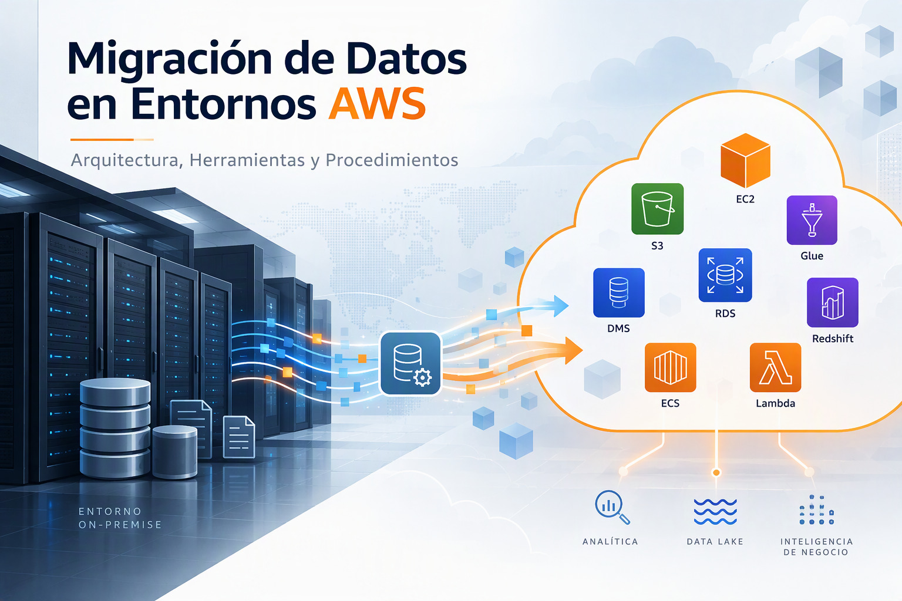
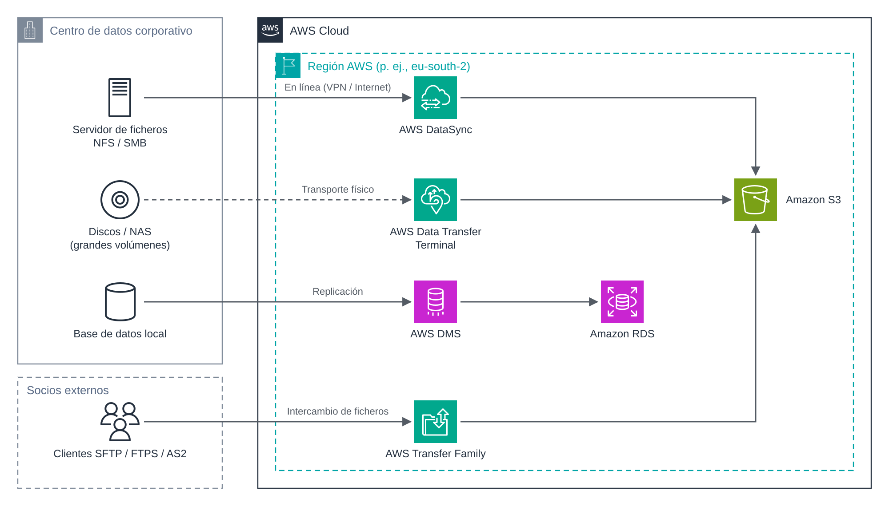

# UD5 · 1. Fundamentos de la migración de datos

## 1. Introducción

Toda organización que adopta la nube se enfrenta, tarde o temprano, al problema de **mover datos**: ficheros de un servidor departamental, copias de seguridad, bases de datos de producción o intercambios periódicos con terceros. Esta operación, que en apariencia consiste simplemente en «copiar», condiciona en realidad el éxito de todo el proyecto: un traslado mal planificado puede provocar pérdida de datos, interrupciones del servicio o costes no previstos.

Este documento presenta el marco conceptual de la unidad: la terminología básica, las estrategias de migración, los criterios para elegir entre transferencia en línea y fuera de línea, el cálculo del tiempo de transferencia y el modelo de costes asociado.

### Objetivos

Al finalizar esta sesión, el alumnado será capaz de:

- Distinguir entre transferencia, sincronización y migración de datos.
- Identificar la estrategia de migración adecuada (las 7R) para un caso dado.
- Estimar el tiempo de una transferencia a partir del volumen de datos y del ancho de banda disponible.
- Reconocer los componentes de coste de una transferencia en AWS.

---

## 2. Conceptos básicos

| Concepto                          | Definición                                                                                                                 | Ejemplo                                                                        |
| --------------------------------- | -------------------------------------------------------------------------------------------------------------------------- | ------------------------------------------------------------------------------ |
| **Transferencia**                 | Copia puntual de un conjunto de datos de un origen a un destino.                                                           | Subir el histórico de facturas de 2020 a un *bucket* S3.                       |
| **Sincronización unidireccional** | Copia periódica que replica en el destino los cambios producidos en el origen.                                             | Cada noche se copian a S3 los ficheros nuevos o modificados del servidor NFS.  |
| **Sincronización bidireccional**  | Los cambios en cualquiera de los extremos se propagan al otro. Exige resolver conflictos.                                  | Carpeta compartida entre la sede y la nube.                                    |
| **Migración**                     | Traslado definitivo de datos (y, a menudo, del sistema que los usa) a un nuevo entorno, con un punto de corte (*cutover*). | Trasladar la base de datos de gestión a Amazon RDS y apagar el servidor local. |

Cualquiera de estas operaciones debe garantizar tres propiedades:

- **Integridad:** los datos llegan completos y sin alteraciones. Se verifica mediante sumas de comprobación (*checksums*) y recuentos.
- **Seguridad:** los datos están cifrados en tránsito y en reposo, y solo los perfiles autorizados intervienen en el proceso.
- **Disponibilidad:** el sistema de origen sigue prestando servicio durante el traslado, o la interrupción se reduce al mínimo aceptable.

---

## 3. Estrategias de migración: las 7R

AWS clasifica las estrategias de migración de aplicaciones en siete categorías, conocidas como **las 7R**. Aunque se formulan para aplicaciones completas, condicionan directamente qué se hace con los datos.

| Estrategia                                                     | Descripción                                                                                                                                                                                                                                                          | Implicación para los datos                                                                                                        |
| -------------------------------------------------------------- | -------------------------------------------------------------------------------------------------------------------------------------------------------------------------------------------------------------------------------------------------------------------- | --------------------------------------------------------------------------------------------------------------------------------- |
| **Retire** (retirar)                                           | Se elimina la aplicación porque ya no aporta valor.                                                                                                                                                                                                                  | Archivado a largo plazo o borrado controlado.                                                                                     |
| **Retain** (retener)                                           | Se mantiene en local, de momento.                                                                                                                                                                                                                                    | Posible sincronización híbrida.                                                                                                   |
| **Rehost** (*lift and shift*)                                  | Se mueven las aplicaciones del entorno de origen al entorno Nube de AWS sin realizar ningún cambio en la aplicación.                                                                                                                                                 | Copia de discos o volúmenes completos.                                                                                            |
| **Relocate** (reubicar)                                        | Se trasladan muchos servidores a la vez desde la plataforma local a su versión en la nube, o se mueven instancias u objetos de AWS a otra VPC, región o cuenta (p. ej., una instancia de Amazon RDS a otra cuenta). Sin cambios en la aplicación ni en la operación. | Los datos viajan con la plataforma o mediante instantáneas compartidas, copias entre regiones o replicación de S3.                |
| **Repurchase** (*drop and shop*)                               | Sustituye la aplicación por una versión o producto diferente.                                                                                                                                                                                                        | Exportación, mapeo e importación en el formato del nuevo producto.                                                                |
| **Replatform** (*lift, tinker and shift* o *lift and reshape*) | Se traslada con optimizaciones, pocas o muchas según los objetivos: servicio gestionado o sin servidor, sistema operativo actualizado, procesadores Graviton, paso de Windows a Linux o de máquinas virtuales a contenedores.                                        | Migración de bases de datos a servicios gestionados; el estado de los contenedores pasa a EFS, S3 o una base de datos gestionada. |
| **Refactor** (rediseñar)                                       | Se reescribe la aplicación para aprovechar servicios nativos de la nube.                                                                                                                                                                                             | Transformación de esquemas y formatos.                                                                                            |

[Revisa la documentación oficial para más detalles](https://docs.aws.amazon.com/es_es/prescriptive-guidance/latest/large-migration-guide/migration-strategies.html)

En migraciones grandes, AWS recomienda usar sobre todo Rehost, Replatform, Relocate y Retire, y modernizar las aplicaciones después de la migración. Refactor, la estrategia más compleja y costosa, se reserva para cuando ninguna otra es aceptable.

AWS organiza además todo proyecto de migración en tres fases:

1. **Evaluación (*assess*):** inventario de datos, volúmenes, dependencias y requisitos legales.
2. **Movilización (*mobilize*):** diseño de la arquitectura de destino, pruebas piloto y plan detallado.
3. **Migración y modernización (*migrate and modernize*):** ejecución del traslado, validación y corte.

---

## 4. Transferencia en línea frente a fuera de línea

La primera decisión técnica es **por dónde viajan los datos**:

- **En línea (*online*):** a través de la red (Internet, VPN o AWS Direct Connect). Es la opción preferente en la gran mayoría de los casos.
- **Fuera de línea (*offline*):** los datos se copian en dispositivos físicos que se transportan hasta un punto de carga de AWS. Solo se justifica con volúmenes muy grandes o conectividad muy limitada.

La figura siguiente muestra el panorama de servicios que se estudiarán en la unidad y el tipo de origen al que responde cada uno.

*Figura 1. Servicios de AWS para transferencia, sincronización y migración de datos según el tipo de origen.*

| Servicio                       | Modalidad      | Caso de uso principal                                                                | Documento |
| ------------------------------ | -------------- | ------------------------------------------------------------------------------------ | --------- |
| AWS CLI (`aws s3 cp`/`sync`)   | En línea       | Cargas sencillas y sincronizaciones ligeras hacia S3.                                | 2         |
| AWS DataSync                   | En línea       | Transferencias y sincronizaciones gestionadas de grandes sistemas de ficheros.       | 3         |
| AWS Transfer Family            | En línea       | Intercambio de ficheros con terceros mediante SFTP, FTPS, FTP o AS2.                 | 4         |
| AWS Database Migration Service | En línea       | Migración y replicación de bases de datos.                                           | Semana 2  |
| AWS Data Transfer Terminal     | Fuera de línea | Carga física de dispositivos propios en una instalación de AWS.                      | 5         |
| AWS Snowball Edge              | Fuera de línea | Envío de dispositivos de AWS. Solo para clientes existentes desde noviembre de 2025. | 5         |

---

## 5. Cálculo del tiempo de transferencia

El tiempo necesario para transferir un volumen de datos por red se estima con la expresión:

$$
T\,(\text{s}) = \frac{V\,(\text{bits})}{B\,(\text{bits/s}) \times \eta}
$$

donde *V* es el volumen de datos, *B* el ancho de banda nominal y *η* la eficiencia real del enlace. Como valor de trabajo se suele tomar **η = 0,8** (80 %), ya que nunca se dispone del ancho de banda completo.

> **Atención a las unidades.** El volumen suele expresarse en *bytes* y el ancho de banda en *bits* por segundo. Hay que multiplicar por 8: 1 TB = 8 × 10¹² bits.

**Ejemplo.** Transferir 10 TB por una línea de 100 Mbps al 80 %:

$$
T = \frac{10 \times 8 \times 10^{12}}{100 \times 10^{6} \times 0{,}8} = 10^{6}\ \text{s} \approx 11{,}6\ \text{días}
$$

| Volumen | 100 Mbps  | 1 Gbps    | 10 Gbps    |
| ------- | --------- | --------- | ---------- |
| 1 TB    | 1,2 días  | 2,8 horas | 17 minutos |
| 10 TB   | 11,6 días | 1,2 días  | 2,8 horas  |
| 100 TB  | 116 días  | 11,6 días | 1,2 días   |

*Tabla calculada con η = 0,8 y unidades decimales.*

Como criterio orientativo, la transferencia fuera de línea empieza a considerarse cuando el traslado por red supera **una semana** o cuando ocuparía un enlace que la organización necesita para su actividad diaria. Antes de descartarla, conviene valorar alternativas como ampliar temporalmente el ancho de banda o transferir solo los datos activos.

---

## 6. Modelo de costes

Una transferencia en AWS combina varios componentes de coste. Identificarlos todos es imprescindible para cumplir el criterio RA5.b.

| Componente                           | Descripción                                                   | Referencia orientativa                                                                                    |
| ------------------------------------ | ------------------------------------------------------------- | --------------------------------------------------------------------------------------------------------- |
| Entrada de datos a AWS               | Datos que llegan desde Internet.                              | Gratuita.                                                                                                 |
| Salida de datos desde AWS            | Datos que salen hacia Internet.                               | Primeros 100 GB/mes gratuitos (agregados entre servicios); después, precio por GB según región y volumen. |
| Transferencia entre zonas o regiones | Tráfico entre zonas de disponibilidad o entre regiones.       | Precio por GB.                                                                                            |
| Servicio de transferencia            | Coste propio del servicio utilizado.                          | DataSync: 0,0125 USD/GB (modo básico). Transfer Family: 0,30 USD por hora y protocolo, más 0,04 USD/GB.   |
| Peticiones                           | Operaciones sobre el destino (por ejemplo, PUT y LIST en S3). | Precio por cada 1000 peticiones.                                                                          |
| Almacenamiento de destino            | Coste mensual de los datos ya migrados.                       | Según clase de almacenamiento.                                                                            |

*Precios de referencia en US East (N. Virginia), consultados en noviembre de 2026. Pueden variar por región y cambiar con el tiempo.*

**Recomendaciones:**

- Utilizar la **AWS Pricing Calculator** (<https://calculator.aws>) para estimar el coste completo antes de iniciar el proyecto.
- Prestar atención a los **costes fijos por tiempo** (por ejemplo, un servidor de Transfer Family se factura por hora mientras exista, aunque no se use).
- En el **Learner Lab**, el crédito es limitado. Hay que eliminar los recursos al terminar cada práctica.

---

## 7. Selección de la región y residencia de los datos

La región de destino condiciona la latencia, el coste y el cumplimiento normativo:

- **Residencia de los datos:** el Reglamento General de Protección de Datos (RGPD) exige garantías adicionales cuando los datos personales salen del Espacio Económico Europeo. Las regiones europeas (por ejemplo, `eu-south-2`, en España) facilitan su cumplimiento.
- **Disponibilidad de servicios:** no todos los servicios ni todas sus funciones están disponibles en todas las regiones. Se debe consultar la lista de servicios por región.
- **Entorno de prácticas:** el Learner Lab restringe las regiones utilizables (habitualmente `us-east-1` y `us-west-2`). En las prácticas se trabajará en ellas, aunque en un proyecto real se elegiría una región europea.

---

## 8. Ideas clave

- Transferir, sincronizar y migrar son operaciones distintas; todas deben preservar la integridad, la seguridad y la disponibilidad.
- La estrategia de migración (7R) determina qué se hace con los datos.
- La transferencia en línea es la opción preferente; la fuera de línea se reserva para volúmenes muy grandes o redes insuficientes.
- El tiempo de transferencia se estima con el volumen, el ancho de banda y una eficiencia realista.
- El coste total incluye la salida de datos, el servicio, las peticiones y el almacenamiento, no solo el precio por GB.

## 9. Preguntas de autoevaluación

1. Una empresa quiere trasladar 40 TB por una línea de 500 Mbps. Estima el tiempo de transferencia con una eficiencia del 80 %. ¿Recomendarías una transferencia en línea?
2. ¿Qué estrategia de las 7R aplicarías a un servidor MySQL que se quiere trasladar a Amazon RDS sin modificar la aplicación?
3. ¿Por qué la entrada de datos a AWS es gratuita, pero no siempre lo es la migración completa?

---

## Referencias

- AWS. *Migration strategies* (AWS Prescriptive Guidance). <https://docs.aws.amazon.com/prescriptive-guidance/latest/large-migration-guide/migration-strategies.html>
- AWS. Acerca de las estrategias de migración (AWS Prescriptive Guidance). Español. <https://docs.aws.amazon.com/es_es/prescriptive-guidance/latest/large-migration-guide/migration-strategies.html>
- AWS. *AWS DataSync pricing*. <https://aws.amazon.com/datasync/pricing/>
- AWS. *AWS Transfer Family pricing*. <https://aws.amazon.com/aws-transfer-family/pricing/>
- AWS. *AWS Pricing Calculator*. <https://calculator.aws>
