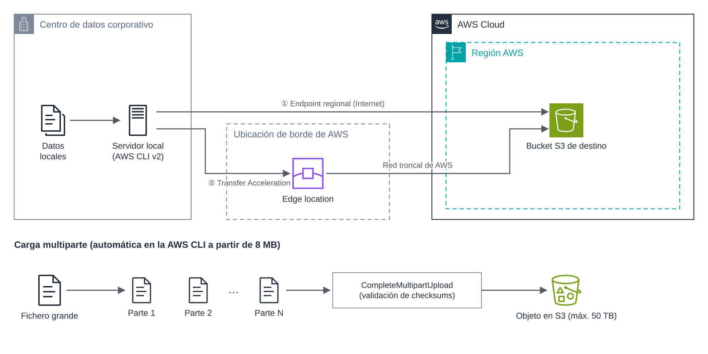

# UD5 · 2. Amazon S3 como destino de datos

## 1. Introducción

Amazon S3 es el destino más habitual de cualquier transferencia de datos a AWS. Su capacidad prácticamente ilimitada, su durabilidad (diseñada para el 99,999999999 %) y su integración con el resto de servicios lo convierten en la «zona de aterrizaje» natural de los datos migrados. Desde S3, los datos pueden archivarse, analizarse o cargarse en otros sistemas.

Este documento aborda cómo preparar un *bucket* para recibir datos y cómo transferirlos con la AWS CLI, incluyendo la sincronización, la carga multiparte, la aceleración y la verificación de integridad.

### Objetivos

- Preparar un *bucket* S3 como destino seguro de una transferencia.
- Utilizar `aws s3 cp` y `aws s3 sync` para cargas puntuales y sincronizaciones unidireccionales.
- Comprender el funcionamiento de la carga multiparte y de S3 Transfer Acceleration.
- Verificar la integridad de los objetos transferidos.

---

## 2. Arquitectura de referencia

La figura muestra las dos vías por las que un servidor local puede cargar datos en S3: directamente contra el *endpoint* regional o a través de una ubicación de borde mediante Transfer Acceleration. En la parte inferior se representa el mecanismo de carga multiparte.



*Figura 2. Vías de carga hacia Amazon S3 y funcionamiento de la carga multiparte.*

---

## 3. Preparación del bucket de destino

Antes de transferir datos conviene configurar el *bucket* con criterios de seguridad y de coste:

| Configuración             | Recomendación                                                           | Motivo                                                                      |
| ------------------------- | ----------------------------------------------------------------------- | --------------------------------------------------------------------------- |
| Región                    | La más próxima a los usuarios y compatible con la normativa.            | Latencia, coste y residencia de los datos.                                  |
| Bloqueo de acceso público | Activado (valor por defecto).                                           | Evita exposiciones accidentales.                                            |
| Cifrado por defecto       | SSE-S3 (activo por defecto) o SSE-KMS si se requiere control de claves. | Cifrado en reposo de todos los objetos.                                     |
| Control de versiones      | Activado si se va a sincronizar con borrado.                            | Permite recuperar objetos sobrescritos o eliminados por error.              |
| Regla de ciclo de vida    | Abortar cargas multiparte incompletas tras 7 días.                      | Las partes huérfanas ocupan espacio y se facturan.                          |
| Clase de almacenamiento   | Elegida según el uso posterior de los datos.                            | Los datos de archivo pueden cargarse directamente en clases más económicas. |

```bash
# Crear el bucket y activar el control de versiones
aws s3 mb s3://ud5-destino-<iniciales> --region us-east-1
aws s3api put-bucket-versioning --bucket ud5-destino-<iniciales> \
    --versioning-configuration Status=Enabled
```

---

## 4. Transferencia con la AWS CLI

### 4.1. Comandos de alto nivel

| Comando       | Función                                                                                          |
| ------------- | ------------------------------------------------------------------------------------------------ |
| `aws s3 cp`   | Copia ficheros u objetos. Con `--recursive`, copia directorios completos.                        |
| `aws s3 mv`   | Mueve ficheros u objetos (copia y borra el origen).                                              |
| `aws s3 sync` | Sincroniza un directorio con un prefijo de S3, o viceversa, copiando solo lo nuevo o modificado. |

### 4.2. Sincronización unidireccional con `aws s3 sync`

`aws s3 sync` compara el origen y el destino y copia únicamente los ficheros **nuevos** o cuyo **tamaño o fecha de modificación** difieren. Por tanto, es **incremental**: la segunda ejecución solo transfiere los cambios.

```bash
# Primera ejecución: copia completa
aws s3 sync /datos s3://ud5-destino-<iniciales>/datos/

# Simulación: muestra qué se haría sin ejecutar nada
aws s3 sync /datos s3://ud5-destino-<iniciales>/datos/ --dryrun

# Excluir ficheros temporales e incluir solo CSV
aws s3 sync /datos s3://ud5-destino-<iniciales>/datos/ \
    --exclude "*" --include "*.csv"

# Replicar también los borrados del origen
aws s3 sync /datos s3://ud5-destino-<iniciales>/datos/ --delete

# Cargar directamente en una clase de almacenamiento de acceso poco frecuente
aws s3 sync /datos s3://ud5-destino-<iniciales>/archivo/ --storage-class STANDARD_IA
```

Aspectos que conviene recordar:

- **Por defecto no se borra nada en el destino.** La opción `--delete` elimina en el destino los objetos que ya no existen en el origen. Debe usarse con precaución y, preferiblemente, con el control de versiones activado.
- **El orden de los filtros importa.** `--exclude` e `--include` se evalúan en el orden escrito, y el último que coincide prevalece.
- **`--dryrun` es obligatorio antes de cualquier sincronización con `--delete`** en un entorno real.

Para automatizar la sincronización, basta con programarla, por ejemplo con `cron`:

```bash
# Sincronización diaria a las 02:00, con registro de la ejecución
0 2 * * * aws s3 sync /datos s3://ud5-destino-<iniciales>/datos/ >> /var/log/s3sync.log 2>&1
```

Esta solución es válida para volúmenes moderados. Para millones de ficheros, verificación avanzada o informes de ejecución, es preferible AWS DataSync (documento 3).

---

## 5. Carga multiparte

La **carga multiparte** (*multipart upload*) divide un fichero grande en partes que se transfieren en paralelo y se ensamblan en S3 al final. Aporta tres ventajas: mayor rendimiento, reintento individual de las partes fallidas y posibilidad de pausar y reanudar.

| Parámetro                               | Valor                                            |
| --------------------------------------- | ------------------------------------------------ |
| Tamaño máximo en una sola operación PUT | 5 GB                                             |
| Tamaño de cada parte                    | De 5 MiB a 5 GiB (la última puede ser menor)     |
| Número máximo de partes                 | 10 000                                           |
| Tamaño máximo de un objeto              | 50 TB (ampliado desde 5 TB en diciembre de 2025) |

La AWS CLI aplica la carga multiparte **automáticamente** a partir de 8 MB. Su comportamiento puede ajustarse:

```bash
aws configure set default.s3.multipart_threshold 64MB
aws configure set default.s3.multipart_chunksize 16MB
aws configure set default.s3.max_concurrent_requests 20
```

Si una carga multiparte se interrumpe y no se completa ni se aborta, las partes ya subidas permanecen en el *bucket* y **se facturan**. Por eso se recomienda la regla de ciclo de vida indicada en el apartado 3.

---

## 6. S3 Transfer Acceleration

**S3 Transfer Acceleration** encamina las cargas a través de la ubicación de borde de AWS más cercana al cliente. Desde allí, los datos viajan por la red troncal de AWS hasta la región del *bucket*. Mejora el rendimiento cuando el cliente está lejos de la región o cuando la ruta por Internet es deficiente.

- Se activa por *bucket*. El nombre del *bucket* debe ser compatible con DNS y no puede contener puntos.
- Se usa un *endpoint* específico: `<bucket>.s3-accelerate.amazonaws.com`.
- Tiene un coste adicional por GB, que solo se cobra cuando la aceleración mejora realmente la transferencia.
- AWS ofrece una herramienta de comparación de velocidad para comprobar el beneficio antes de activarla.

```bash
aws s3api put-bucket-accelerate-configuration \
    --bucket ud5-destino-<iniciales> --accelerate-configuration Status=Enabled
# Indicar a la CLI que use el endpoint acelerado
aws configure set default.s3.use_accelerate_endpoint true
aws s3 cp fichero.zip s3://ud5-destino-<iniciales>/
```

---

## 7. Verificación de la integridad

Desde finales de 2024, Amazon S3 aplica **protecciones de integridad por defecto**: las versiones actuales de los SDK y de la AWS CLI calculan una suma de comprobación basada en CRC para cada carga y S3 la valida antes de almacenar el objeto. En la AWS CLI v2, el algoritmo por defecto es **CRC64NVME**, y la suma queda guardada en los metadatos del objeto.

```bash
# Consultar la suma de comprobación almacenada de un objeto
aws s3api head-object --bucket ud5-destino-<iniciales> \
    --key datos/clientes.csv --checksum-mode ENABLED
```

Además de la verificación automática, una migración debe incluir una **comprobación final** independiente:

- Comparar el **número de ficheros** y el **tamaño total** en origen y destino (`aws s3 ls --recursive --summarize`).
- Repetir `aws s3 sync --dryrun`: si no propone ninguna copia, origen y destino coinciden.
- En datos críticos, comparar sumas de comprobación de una muestra de ficheros.

> **Nota.** La ETag de un objeto **no** equivale siempre a su hash MD5. En cargas multiparte o cifradas con SSE-KMS tiene otro formato, por lo que no debe usarse como verificación de integridad.

---

## 8. Ideas clave

- S3 es el destino habitual de las transferencias; el *bucket* debe prepararse antes con cifrado, bloqueo de acceso público y, si procede, control de versiones.
- `aws s3 sync` realiza sincronizaciones unidireccionales incrementales; `--delete` replica los borrados y debe usarse con precaución.
- La carga multiparte es automática en la CLI para ficheros grandes; las cargas incompletas deben limpiarse con una regla de ciclo de vida.
- Transfer Acceleration mejora las transferencias desde ubicaciones lejanas a cambio de un coste adicional.
- S3 verifica la integridad por defecto mediante sumas CRC, pero la migración debe validarse también de forma independiente.

## 9. Preguntas de autoevaluación

1. Ejecutas `aws s3 sync` dos veces seguidas sin cambios en el origen. ¿Qué ocurre en la segunda ejecución? ¿Y si has borrado un fichero en el origen entre ambas?
2. ¿Por qué se recomienda activar el control de versiones en un *bucket* que recibe sincronizaciones con `--delete`?
3. Un fichero de 12 GB no puede subirse con una sola operación PUT. ¿Qué mecanismo lo resuelve y cuántas partes de 16 MB generaría aproximadamente?

---

## Referencias

- AWS. *AWS CLI Command Reference: s3 sync*. <https://docs.aws.amazon.com/cli/latest/reference/s3/sync.html>
- AWS. *Uploading and copying objects using multipart upload*. <https://docs.aws.amazon.com/AmazonS3/latest/userguide/mpuoverview.html>
- AWS. *Configuring fast, secure file transfers using Amazon S3 Transfer Acceleration*. <https://docs.aws.amazon.com/AmazonS3/latest/userguide/transfer-acceleration.html>
- AWS. *Checking object integrity in Amazon S3*. <https://docs.aws.amazon.com/AmazonS3/latest/userguide/checking-object-integrity.html>
- AWS. *Data Integrity Protections for Amazon S3* (AWS SDKs and Tools Reference Guide). <https://docs.aws.amazon.com/sdkref/latest/guide/feature-dataintegrity.html>
- AWS. *Amazon S3 increases the maximum object size to 50 TB* (diciembre de 2025). <https://aws.amazon.com/about-aws/whats-new/2025/12/amazon-s3-maximum-object-size-50-tb/>
