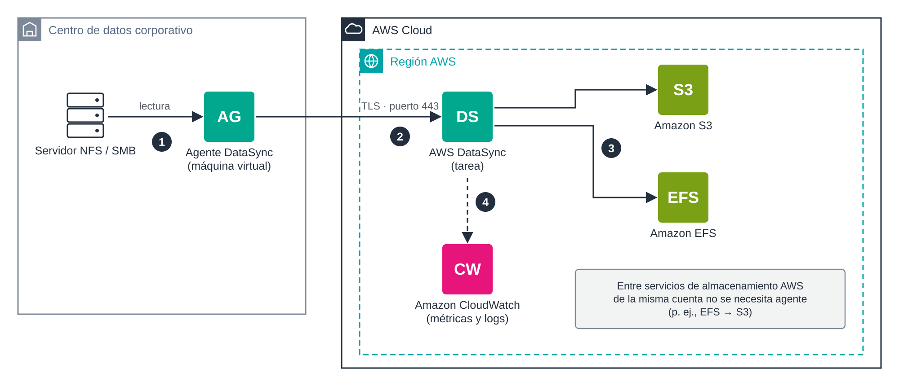

# UD5 · 3. AWS DataSync

> **Módulo:** 5162 · Administración de bases de datos y almacenamiento en la nube
> **Unidad didáctica:** UD5 · Transferencia, sincronización y migración de datos
> **Temporalización:** semana 1 · sesión 3 (práctica corta en las sesiones 4 y 5)
> **Resultados de aprendizaje:** RA5 (criterios a, c, e, f, h) · RA6 (criterios a, e, g)

---

## 1. Introducción

**AWS DataSync** es un servicio gestionado de transferencia de datos en línea. Automatiza el movimiento de ficheros y objetos entre sistemas de almacenamiento locales, servicios de almacenamiento de AWS y otras nubes. Frente a una herramienta como `aws s3 sync`, DataSync se encarga del paralelismo, el cifrado, los reintentos, la verificación de integridad, la programación y el registro de cada ejecución.

Sus casos de uso típicos son:

- **Migración** de sistemas de ficheros completos (NFS, SMB, HDFS) a AWS.
- **Archivado** de datos fríos en clases de almacenamiento económicas de S3.
- **Replicación** periódica entre servicios de AWS, por ejemplo de Amazon EFS a S3.
- **Flujos híbridos**, en los que los datos generados en local se envían regularmente a la nube para su análisis.

### Objetivos

- Identificar los componentes de DataSync: agente, ubicaciones, tareas y ejecuciones.
- Determinar cuándo es necesario desplegar un agente.
- Configurar una tarea con verificación, filtros, límite de ancho de banda y programación.
- Monitorizar las ejecuciones y estimar su coste.

---

## 2. Arquitectura



*Figura 3. Transferencia desde un servidor de ficheros local hacia Amazon S3 y Amazon EFS mediante AWS DataSync.*

El flujo numerado en la figura es el siguiente:

1. El **agente** lee los datos del servidor NFS o SMB local.
2. El agente los envía cifrados con TLS al servicio DataSync de la región, por el puerto 443.
3. DataSync escribe los datos en la **ubicación de destino** (S3, EFS, FSx…).
4. Las métricas y los registros de cada ejecución se publican en **Amazon CloudWatch**.

---

## 3. Componentes

| Componente | Descripción |
|---|---|
| **Agente** | Máquina virtual que se despliega junto al almacenamiento de origen y lee o escribe sus datos. Se instala en VMware ESXi, KVM o Microsoft Hyper-V, o como instancia de Amazon EC2. Tras desplegarlo, se **activa** para asociarlo a la cuenta y a la región. |
| **Ubicación** (*location*) | Definición de un origen o destino: tipo de almacenamiento, ruta y credenciales o rol de acceso. |
| **Tarea** (*task*) | Asocia una ubicación de origen con una de destino e incluye las opciones de transferencia. |
| **Ejecución** (*task execution*) | Cada ejecución concreta de una tarea, con su propio estado, métricas e informe. |

### 3.1. ¿Es necesario un agente?

| Escenario | Agente |
|---|---|
| Almacenamiento local (NFS, SMB, HDFS, almacenamiento de objetos propio) ↔ AWS | **Sí** |
| Amazon EFS o Amazon FSx ↔ almacenamiento en otra nube | **Sí** |
| Entre servicios de almacenamiento de AWS de la misma cuenta (p. ej., EFS → S3) | No |
| Amazon S3 ↔ otro servicio de AWS en otra cuenta | No |
| Amazon S3 ↔ almacenamiento de objetos de otras nubes | No |

La mayoría de las transferencias necesitan un único agente. Para conjuntos con millones de ficheros se pueden asignar hasta cuatro agentes a una ubicación, o dividir el trabajo en varias tareas paralelas. Varios agentes **no** proporcionan alta disponibilidad: todos deben estar en línea para que la tarea arranque.

> **En el Learner Lab** se trabajará con transferencias entre servicios de AWS (EFS → S3), que no requieren agente.

### 3.2. Tipos de ubicación

- **Locales u otras nubes:** NFS, SMB, HDFS, almacenamiento de objetos compatible con S3 y Azure Blob Storage.
- **AWS:** Amazon S3, Amazon EFS y Amazon FSx (Windows File Server, Lustre, NetApp ONTAP y OpenZFS).

---

## 4. Modos de tarea

| | Modo básico (*Basic*) | Modo mejorado (*Enhanced*) |
|---|---|---|
| Funcionamiento | Prepara, transfiere y verifica los ficheros de forma secuencial. | Lista, prepara, transfiere y verifica en paralelo. |
| Escala | Sujeto a cuotas de número de ficheros por ejecución. | Número prácticamente ilimitado de objetos. |
| Ubicaciones | Todas las disponibles. | S3, EFS, FSx for Lustre y FSx for OpenZFS, frente a NFS, SMB, HDFS, almacenamiento de objetos y Azure Blob. |
| Agente | Agente en modo básico. | Agente en modo mejorado. |
| Precio | 0,0125 USD por GB transferido. | 0,015 USD por GB más 0,55 USD por ejecución. |

*Precios de referencia en US East (N. Virginia), noviembre de 2026.*

---

## 5. Opciones de configuración de una tarea

| Opción | Valores habituales | Utilidad |
|---|---|---|
| **Modo de transferencia** | Solo datos modificados / todos los datos | La primera opción hace la sincronización incremental. |
| **Verificación** | Solo ficheros transferidos / todo el destino / ninguna | Comprueba la integridad mediante sumas de comprobación al terminar. |
| **Ficheros borrados en el origen** | Conservar / eliminar en el destino | Equivale a la opción `--delete` de `aws s3 sync`. |
| **Sobrescritura** | Permitir / no permitir | Protege ficheros modificados en el destino. |
| **Metadatos** | Conservar propietarios, permisos POSIX y marcas de tiempo | Imprescindible en migraciones de sistemas de ficheros. |
| **Filtros** | Patrones de inclusión y exclusión (p. ej., `*.tmp`) | Limita qué se transfiere. |
| **Límite de ancho de banda** | MiB/s | Evita saturar el enlace de la organización. |
| **Programación** | Expresión `cron` o `rate` (intervalo mínimo de una hora) | Sincronización automática y desatendida. |
| **Informe de tarea** | Resumen o detallado, guardado en S3 | Evidencia de qué se transfirió, omitió o verificó. |
| **Registro** | Grupo de CloudWatch Logs | Diagnóstico de errores. |

Cada ejecución pasa por las fases **Lanzamiento → Preparación → Transferencia → Verificación** y termina en **Éxito** o **Error**. En la fase de preparación, DataSync compara origen y destino para decidir qué debe copiar.

---

## 6. Ejemplo con la AWS CLI: de Amazon EFS a Amazon S3

Este ejemplo reproduce el escenario de la práctica corta. Requiere un sistema de ficheros EFS con un destino de montaje, un *bucket* S3 y un rol con permisos sobre el *bucket* (en el Learner Lab, `LabRole`).

```bash
# 1. Ubicación de origen: EFS
#    DataSync crea interfaces de red en la subred indicada; el grupo de seguridad
#    debe permitir el tráfico NFS (TCP 2049) hacia el destino de montaje de EFS.
aws datasync create-location-efs \
    --efs-filesystem-arn arn:aws:elasticfilesystem:us-east-1:<cuenta>:file-system/<fs-id> \
    --ec2-config SubnetArn=arn:aws:ec2:us-east-1:<cuenta>:subnet/<subnet-id>,SecurityGroupArns=arn:aws:ec2:us-east-1:<cuenta>:security-group/<sg-id>

# 2. Ubicación de destino: S3
aws datasync create-location-s3 \
    --s3-bucket-arn arn:aws:s3:::ud5-destino-<iniciales> \
    --subdirectory /datasync \
    --s3-config BucketAccessRoleArn=arn:aws:iam::<cuenta>:role/LabRole

# 3. Tarea con verificación, transferencia incremental, filtro y programación diaria
aws datasync create-task --name ud5-efs-a-s3 \
    --source-location-arn <arn-ubicacion-efs> \
    --destination-location-arn <arn-ubicacion-s3> \
    --options VerifyMode=ONLY_FILES_TRANSFERRED,TransferMode=CHANGED \
    --excludes FilterType=SIMPLE_PATTERN,Value="*.tmp" \
    --schedule ScheduleExpression="cron(0 2 * * ? *)"

# 4. Ejecución manual y seguimiento
aws datasync start-task-execution --task-arn <arn-tarea>
aws datasync describe-task-execution --task-execution-arn <arn-ejecucion>
```

La salida de `describe-task-execution` incluye el estado, los bytes y ficheros transferidos y el resultado de la verificación.

---

## 7. Red y seguridad

- **Cifrado en tránsito:** todo el tráfico entre el agente y el servicio viaja cifrado con TLS.
- **Cifrado en reposo:** depende del destino (cifrado de S3 o de EFS).
- **Tipo de *endpoint* del servicio:** público, FIPS o de VPC. Con un *endpoint* de VPC (AWS PrivateLink), el tráfico del agente no atraviesa Internet. Se estudia en el documento 7.
- **Permisos:** DataSync accede a S3 asumiendo un rol IAM, que debe limitarse al *bucket* y prefijo necesarios.
- **Red local:** el agente solo necesita conexiones **salientes** hacia AWS (principalmente el puerto 443). No hay que abrir puertos entrantes desde Internet.

---

## 8. Monitorización

- **Métricas en CloudWatch:** bytes y ficheros transferidos, preparados y verificados en cada ejecución.
- **Registros en CloudWatch Logs:** detalle de los ficheros con error.
- **Eventos en Amazon EventBridge:** cambios de estado de las ejecuciones, útiles para enviar una notificación cuando una tarea falla.
- **Informes de tarea:** fichero en S3 con el resultado de cada fichero.

---

## 9. DataSync frente a otras herramientas

| Criterio | `aws s3 sync` | AWS DataSync |
|---|---|---|
| Despliegue | Ninguno; basta la CLI. | Agente (si el origen es local) y configuración de tareas. |
| Escala | Adecuada para volúmenes moderados. | Diseñado para millones de ficheros y petabytes. |
| Verificación | Básica. | Integrada, con informes. |
| Programación | Externa (`cron`). | Integrada. |
| Destinos | S3. | S3, EFS, FSx y otros. |
| Coste | Solo peticiones y almacenamiento. | Precio por GB transferido. |

---

## 10. Ideas clave

- DataSync automatiza transferencias en línea con cifrado, paralelismo, verificación y programación.
- Necesita un agente cuando intervienen almacenamiento local u otras nubes; entre servicios de AWS de la misma cuenta, no.
- Una tarea une dos ubicaciones; sus opciones controlan la incrementalidad, la verificación, los filtros y el ancho de banda.
- CloudWatch, EventBridge y los informes de tarea permiten supervisar cada ejecución.

## 11. Preguntas de autoevaluación

1. ¿Por qué no es necesario desplegar un agente para transferir datos de Amazon EFS a Amazon S3 dentro de la misma cuenta?
2. Una tarea programada diariamente copia 50 GB nuevos cada día en modo básico. Estima su coste mensual de DataSync.
3. ¿Qué opción de la tarea usarías para que la transferencia no sature la línea de la empresa en horario laboral?

---

## Referencias

- AWS. *What is AWS DataSync?* <https://docs.aws.amazon.com/datasync/latest/userguide/what-is-datasync.html>
- AWS. *Do I need an AWS DataSync agent?* <https://docs.aws.amazon.com/datasync/latest/userguide/do-i-need-datasync-agent.html>
- AWS. *AWS DataSync pricing*. <https://aws.amazon.com/datasync/pricing/>
