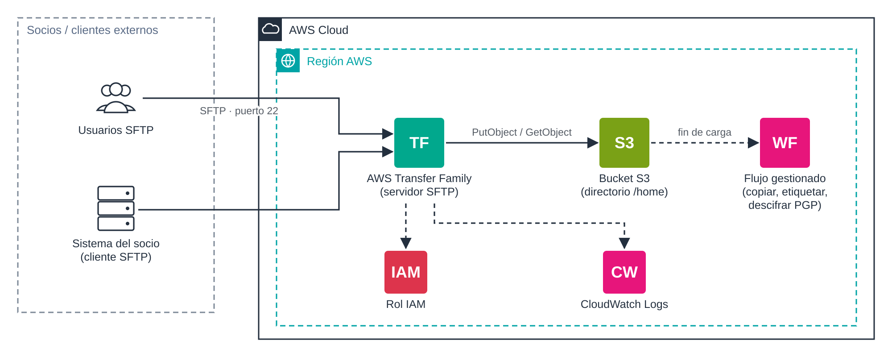

# UD5 · 4. AWS Transfer Family

> **Módulo:** 5162 · Administración de bases de datos y almacenamiento en la nube
> **Unidad didáctica:** UD5 · Transferencia, sincronización y migración de datos
> **Temporalización:** semana 1 · sesión 6
> **Resultados de aprendizaje:** RA5 (criterios a, b, c, e, g) · RA6 (criterios c, d)

---

## 1. Introducción

Muchas organizaciones intercambian ficheros a diario con proveedores, clientes, bancos o administraciones mediante protocolos clásicos como SFTP o FTPS. Estos socios tienen procesos y *scripts* que no van a modificar porque su interlocutor migre a la nube.

**AWS Transfer Family** resuelve este escenario. Ofrece servidores gestionados de **SFTP, FTPS, FTP y AS2** que almacenan los ficheros directamente en **Amazon S3** o **Amazon EFS**. Los socios siguen conectándose como siempre, mientras que la organización deja de mantener servidores de ficheros propios.

### Objetivos

- Identificar los protocolos y los tipos de *endpoint* que ofrece Transfer Family.
- Comprender las opciones de gestión de usuarios y el aislamiento mediante directorios lógicos.
- Conocer los flujos gestionados de postprocesamiento.
- Valorar su coste y compararlo con DataSync.

---

## 2. Arquitectura



*Figura 4. Intercambio de ficheros con socios externos mediante un servidor SFTP gestionado que almacena en Amazon S3.*

El cliente SFTP del socio se conecta al *endpoint* del servidor. Transfer Family autentica al usuario y asume el **rol IAM** asociado para leer o escribir en el *bucket*. Las sesiones se registran en **CloudWatch Logs**. Al terminar una carga, puede lanzarse un **flujo gestionado** que procesa el fichero.

---

## 3. Protocolos

| Protocolo | Seguridad | Puerto | Uso típico | Restricciones |
|---|---|---|---|---|
| **SFTP** | Cifrado mediante SSH. | 22 | Intercambio seguro de ficheros; el más extendido. | — |
| **FTPS** | Cifrado mediante TLS. | 21 (control) y rango de puertos pasivos | Socios con infraestructura FTP que exigen cifrado. | Requiere *endpoint* de VPC y certificado de AWS Certificate Manager. |
| **FTP** | **Sin cifrado**. | 21 y puertos pasivos | Aplicaciones heredadas en redes internas. | Solo *endpoint* de VPC interno; nunca expuesto a Internet. |
| **AS2** | Firma y cifrado de mensajes, con acuse de recibo (MDN). | HTTP/HTTPS | Intercambio electrónico de documentos (EDI) entre empresas. | Configuración de socios comerciales y certificados. |

Además de los servidores, la familia incluye **conectores SFTP**, que permiten enviar o recoger ficheros de servidores SFTP externos, y **aplicaciones web**, que ofrecen a usuarios no técnicos un acceso a S3 desde el navegador.

---

## 4. Tipos de endpoint

| Tipo | Accesibilidad | Control de red |
|---|---|---|
| **Público** | Desde Internet, con un nombre DNS proporcionado por AWS. | Sin grupos de seguridad. Solo admite SFTP. |
| **VPC, interno** | Solo desde la VPC y redes conectadas (VPN, Direct Connect). | Grupos de seguridad. |
| **VPC, con acceso desde Internet** | Desde Internet mediante direcciones IP elásticas fijas. | Grupos de seguridad, lo que permite restringir el acceso a las IP de cada socio. |

La opción de VPC con acceso desde Internet es la habitual en entornos profesionales: los socios suelen exigir una IP fija para sus cortafuegos, y la organización puede limitar el acceso a las direcciones de cada socio.

---

## 5. Gestión de usuarios

### 5.1. Proveedores de identidad

| Proveedor | Autenticación | Uso |
|---|---|---|
| **Gestionado por el servicio** | Claves SSH públicas almacenadas en Transfer Family. | Pocos usuarios y solo SFTP. Es la opción más sencilla. |
| **AWS Directory Service** | Credenciales de Microsoft Active Directory. | Usuarios corporativos ya existentes en AD. |
| **Proveedor personalizado** | Función AWS Lambda o API de Amazon API Gateway que valida las credenciales. | Integración con sistemas propios, autenticación por contraseña o múltiples factores. |

### 5.2. Configuración de cada usuario

Cada usuario se define con:

- **Rol IAM:** determina a qué *bucket* o sistema de ficheros puede acceder Transfer Family en su nombre.
- **Política de sesión (opcional):** restringe aún más los permisos del rol para ese usuario concreto.
- **Directorio de inicio:** carpeta en la que comienza la sesión.
- **Directorios lógicos:** asignan rutas visibles para el usuario a rutas reales de S3 o EFS. Así, el usuario queda **encerrado** en su carpeta (equivalente a un *chroot*) y no ve la estructura real del almacenamiento.
- **Perfil POSIX** (solo con EFS): identificadores de usuario y grupo para aplicar los permisos del sistema de ficheros.

---

## 6. Flujos gestionados

Un **flujo gestionado** (*managed workflow*) es una secuencia de pasos que se ejecuta automáticamente cuando termina la carga de un fichero. Los pasos predefinidos son:

- **Copiar** el fichero a otra ubicación.
- **Etiquetar** el objeto (útil para políticas de ciclo de vida o de copias de seguridad).
- **Descifrar** ficheros cifrados con PGP.
- **Eliminar** el fichero original.
- **Paso personalizado** mediante una función Lambda (por ejemplo, validar el formato).

Cada flujo puede definir pasos de **gestión de excepciones** para cuando falla alguno de los anteriores.

---

## 7. Ejemplo con la AWS CLI

> **Advertencia de coste.** Un servidor de Transfer Family se factura **por hora y por protocolo mientras exista**, se use o no (unos 216 USD al mes por un solo protocolo). En el Learner Lab, este ejemplo debe realizarse como demostración breve y el servidor debe **eliminarse inmediatamente** después.

```bash
# 1. Servidor SFTP público con usuarios gestionados por el servicio
aws transfer create-server \
    --protocols SFTP \
    --endpoint-type PUBLIC \
    --identity-provider-type SERVICE_MANAGED \
    --tags Key=Proyecto,Value=UD5

# 2. Usuario encerrado en su carpeta del bucket mediante un directorio lógico
aws transfer create-user \
    --server-id <id-servidor> \
    --user-name socio01 \
    --role arn:aws:iam::<cuenta>:role/LabRole \
    --home-directory-type LOGICAL \
    --home-directory-mappings '[{"Entry":"/","Target":"/ud5-destino-<iniciales>/socios/socio01"}]' \
    --ssh-public-key-body "$(cat ~/.ssh/socio01.pub)"

# 3. Conexión desde el cliente
sftp -i ~/.ssh/socio01 socio01@<id-servidor>.server.transfer.us-east-1.amazonaws.com

# 4. Eliminación del servidor al terminar
aws transfer delete-server --server-id <id-servidor>
```

---

## 8. Monitorización y auditoría

- **CloudWatch Logs:** registros estructurados de cada sesión (conexiones, autenticaciones, ficheros abiertos, cargados y descargados). Requiere asignar al servidor un rol de registro.
- **Métricas de CloudWatch:** bytes y ficheros de entrada y salida, y ejecuciones de flujos gestionados.
- **AWS CloudTrail:** registro de las llamadas a la API, como la creación de usuarios o la modificación del servidor.

---

## 9. Costes

| Concepto | Precio de referencia |
|---|---|
| Protocolo habilitado en un servidor | 0,30 USD por hora y protocolo. |
| Datos cargados o descargados | 0,04 USD por GB. |
| Mensajes AS2, conectores, flujos y aplicaciones web | Tarifas adicionales según uso. |

*Precios de referencia en US East (N. Virginia), noviembre de 2026.*

A diferencia de la mayoría de los servicios de transferencia, Transfer Family tiene un **coste fijo** por el tiempo de vida del servidor. Por eso conviene agrupar varios socios en un mismo servidor y no habilitar protocolos innecesarios.

---

## 10. Transfer Family frente a DataSync

| Criterio | AWS DataSync | AWS Transfer Family |
|---|---|---|
| Quién inicia la transferencia | La organización, mediante tareas. | El usuario o el socio, desde su cliente. |
| Protocolos | Lectura de NFS, SMB, HDFS y almacenamiento de objetos. | SFTP, FTPS, FTP y AS2. |
| Caso típico | Migración o sincronización masiva de sistemas propios. | Intercambio continuo con terceros. |
| Modelo de coste | Por GB transferido. | Por hora de servidor más GB transferido. |

---

## 11. Ideas clave

- Transfer Family ofrece servidores SFTP, FTPS, FTP y AS2 gestionados, con almacenamiento en S3 o EFS.
- Los socios mantienen sus procesos; la organización elimina la gestión de servidores propios.
- El *endpoint* de VPC permite IP fijas y control mediante grupos de seguridad.
- Los directorios lógicos aíslan a cada usuario en su carpeta.
- El servidor se factura por hora mientras exista: hay que eliminarlo cuando no se use.

## 12. Preguntas de autoevaluación

1. Un banco exige conectarse a una IP fija y que solo su red pueda acceder al servidor. ¿Qué tipo de *endpoint* configurarías?
2. ¿Por qué FTP solo puede habilitarse en un *endpoint* de VPC interno?
3. ¿Qué mecanismo usarías para que cada proveedor solo vea su propia carpeta del *bucket*?

---

## Referencias

- AWS. *What is AWS Transfer Family?* <https://docs.aws.amazon.com/transfer/latest/userguide/what-is-aws-transfer-family.html>
- AWS. *AWS Transfer Family pricing*. <https://aws.amazon.com/aws-transfer-family/pricing/>
