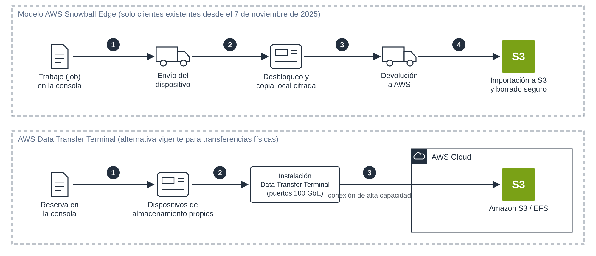

# UD5 · 5. Transferencia fuera de línea

> **Módulo:** 5162 · Administración de bases de datos y almacenamiento en la nube
> **Unidad didáctica:** UD5 · Transferencia, sincronización y migración de datos
> **Temporalización:** semana 1 · sesión 7
> **Resultados de aprendizaje:** RA5 (criterios a, b, d)

---

## 1. Introducción

Cuando el volumen de datos es muy grande o la conectividad es insuficiente, transferir por red puede tardar semanas o meses (véase el apartado 5 del documento 1). En estos casos, puede ser más rápido **transportar físicamente** los datos hasta un punto de carga de AWS. Esta modalidad se denomina **transferencia fuera de línea** (*offline*).

Durante una década, la solución de AWS para este escenario fue la **familia AWS Snow**: dispositivos que AWS enviaba al cliente. En 2025 esta oferta dejó de estar disponible para nuevos clientes, y AWS orienta ahora la transferencia física hacia **AWS Data Transfer Terminal**. Este documento estudia ambos modelos: el primero, por su valor conceptual y porque sigue en uso por clientes existentes; el segundo, como alternativa vigente.

### Objetivos

- Determinar cuándo está justificada una transferencia fuera de línea.
- Describir el ciclo de vida de un trabajo de importación con Snowball Edge y sus garantías de seguridad.
- Conocer la situación actual de la familia Snow y sus alternativas.
- Describir el funcionamiento y el modelo de costes de AWS Data Transfer Terminal.

---

## 2. ¿Cuándo transferir fuera de línea?

Se considera la transferencia física cuando se cumple alguna de estas condiciones:

- El tiempo estimado de transferencia por red supera el plazo disponible para el proyecto (como orientación, más de una semana).
- El enlace de red es necesario para la actividad diaria y no puede dedicarse a la migración.
- El origen está en una ubicación remota con conectividad escasa o inexistente.
- Ampliar temporalmente el ancho de banda resulta más caro que el transporte físico.

Antes de optar por ella, conviene comprobar si basta con transferir solo los datos activos o con contratar una conexión dedicada temporal (AWS Direct Connect) y usar DataSync.

---

## 3. La familia AWS Snow

### 3.1. Evolución y situación actual

| Dispositivo | Características | Situación |
|---|---|---|
| **Snowcone** | Dispositivo pequeño y ligero para entornos de borde. | Retirado: no puede pedirse desde noviembre de 2024. |
| **Snowball Edge Storage Optimized** | Dispositivo robusto para transferencia masiva; la última generación ofrece 210 TB. | Solo para clientes existentes desde el 7 de noviembre de 2025. |
| **Snowball Edge Compute Optimized** | Orientado a computación en el borde, con almacenamiento local. | Solo para clientes existentes desde el 7 de noviembre de 2025. |
| **Snowmobile** | Contenedor de transporte para volúmenes de exabytes. | Retirado. |

Desde el 7 de noviembre de 2025, **AWS no acepta nuevos clientes** en Snowball Edge. Para nuevos proyectos recomienda:

- **AWS DataSync** para transferencias en línea.
- **AWS Data Transfer Terminal** para transferencias físicas seguras.
- **Soluciones de socios de AWS** para casos específicos.
- **AWS Outposts** como alternativa a los casos de computación en el borde.

### 3.2. Ciclo de vida de un trabajo de importación

Aunque ya no puede contratarse, el modelo Snowball ilustra bien las garantías que exige cualquier transferencia física:

*Figura 5. Ciclo de un trabajo de importación con Snowball Edge (arriba) y flujo de carga con AWS Data Transfer Terminal (abajo).*

1. **Creación del trabajo** en la consola: tipo (importación a S3, exportación desde S3 o computación local), *bucket* de destino, clave de AWS KMS y dirección de envío.
2. **Envío del dispositivo** al cliente. Su estado puede seguirse mediante notificaciones de Amazon SNS.
3. **Desbloqueo y copia local.** El cliente descarga de la consola un **manifiesto** y un **código de desbloqueo**, que se distribuyen por separado, y desbloquea el dispositivo con el cliente de Snowball Edge. Los datos se copian mediante su interfaz compatible con S3 o mediante NFS y se cifran en el propio dispositivo.
4. **Devolución.** La etiqueta de envío electrónica del dispositivo se actualiza automáticamente con la dirección de AWS.
5. **Importación y borrado.** AWS carga los datos en el *bucket* y, a continuación, **borra el dispositivo** siguiendo las directrices del NIST para la sanitización de soportes.

### 3.3. Garantías de seguridad

- **Cifrado obligatorio** con claves de 256 bits gestionadas en AWS KMS. Las claves **no se almacenan** en el dispositivo.
- **Separación de credenciales:** el manifiesto y el código de desbloqueo se obtienen por separado; con uno solo no se puede acceder a los datos.
- **Protección física:** carcasa con detección de manipulación y módulo de plataforma segura (TPM).
- **Cadena de custodia** trazable durante todo el transporte.
- **Borrado certificado** tras la importación.

---

## 4. AWS Data Transfer Terminal

### 4.1. Funcionamiento

**AWS Data Transfer Terminal** es una red de **instalaciones físicas seguras** a las que el cliente lleva sus propios dispositivos de almacenamiento para cargar los datos en AWS mediante una conexión de alta capacidad. A diferencia de Snowball, no es AWS quien envía un dispositivo: es el cliente quien se desplaza.

El proceso es el siguiente:

1. **Reserva** de una franja horaria en la consola de AWS, indicando el personal autorizado.
2. **Desplazamiento** a la instalación con los dispositivos. El acceso es controlado y la ubicación exacta de la sala se mantiene discreta por seguridad.
3. **Conexión** de los dispositivos a los puertos de red de alta velocidad (por ejemplo, de 100 GbE) mediante fibra óptica.
4. **Carga** de los datos a los *endpoints* públicos de AWS (Amazon S3, Amazon EFS y otros) y **verificación** de la transferencia.

En febrero de 2026, el servicio contaba con 11 ubicaciones en el mundo. En Europa estaban disponibles **Múnich, Londres y París**.

### 4.2. Modelo de costes

Se factura por **hora de puerto** reservada, aunque no se esté transfiriendo. El precio depende de la ubicación del terminal y de la región de destino.

| Terminal | Destino | Precio por hora de puerto |
|---|---|---|
| Norteamérica | Norteamérica | 300 USD |
| Norteamérica | Europa | 500 USD |
| Europa | Norteamérica | 500 USD |

No hay cargo por GB cuando los datos se cargan en regiones del mismo continente que el terminal. Antes de reservar, conviene consultar los requisitos de acceso vigentes y los precios de la ubicación concreta.

---

## 5. Comparativa de opciones para grandes volúmenes

| Criterio | DataSync con red dedicada | Data Transfer Terminal | Snowball Edge |
|---|---|---|---|
| Disponibilidad para nuevos clientes | Sí | Sí | No (desde noviembre de 2025) |
| Modalidad | En línea | Física, en una instalación de AWS | Física, con envío del dispositivo |
| Dispositivos | No aplica | Propios del cliente | De AWS |
| Coste principal | Por GB más el enlace | Por hora de puerto | Por trabajo, días de uso y envío |
| Sincronización posterior | Sí, incremental | No; requiere otra herramienta | No; requiere otra herramienta |

Un patrón habitual en migraciones grandes combina ambas modalidades: una **carga inicial física** del grueso de los datos y, después, una **sincronización incremental en línea** con DataSync de los cambios producidos mientras tanto.

---

## 6. Recomendaciones de seguridad para cualquier transferencia física

- **Cifrar los datos antes del transporte**, con claves que no viajen junto al soporte.
- **Documentar la cadena de custodia**: quién manipula el soporte, cuándo y dónde.
- **Verificar la integridad tras la carga** mediante sumas de comprobación y recuentos (documento 2, apartado 7).
- **Borrar de forma segura** los soportes una vez confirmada la carga.

---

## 7. Ideas clave

- La transferencia física se justifica cuando la red no permite cumplir los plazos o no puede dedicarse a la migración.
- Snowball Edge ya no admite nuevos clientes desde el 7 de noviembre de 2025; Snowcone y Snowmobile están retirados.
- El modelo Snowball ilustra las garantías básicas: cifrado con claves externas, separación de credenciales, cadena de custodia y borrado certificado.
- AWS Data Transfer Terminal es la alternativa física vigente: el cliente lleva sus dispositivos a una instalación de AWS y paga por hora de puerto.
- La combinación de carga física inicial y sincronización en línea posterior es un patrón frecuente.

## 8. Preguntas de autoevaluación

1. ¿Por qué el código de desbloqueo y el manifiesto de un Snowball se distribuyen por separado?
2. Una empresa debe migrar 500 TB a `eu-south-2` y dispone de una línea de 1 Gbps. Calcula el tiempo por red y razona qué alternativas tendría hoy.
3. ¿Qué herramienta usarías para trasladar los cambios producidos en el origen después de una carga física inicial?

---

## Referencias

- AWS. *Amazon Snowball Edge availability change* (Snowball Edge Developer Guide). <https://docs.aws.amazon.com/snowball/latest/developer-guide/snowball-edge-availability-change.html>
- AWS Storage Blog. *AWS Snow device updates*. <https://aws.amazon.com/blogs/storage/aws-snow-device-updates>
- AWS News Blog. *New physical AWS Data Transfer Terminals let you upload to the cloud faster*. <https://aws.amazon.com/blogs/aws/new-physical-aws-data-transfer-terminals-let-you-upload-to-the-cloud-faster>
- AWS. *AWS announces 6 new locations for AWS Data Transfer Terminal* (febrero de 2026). <https://aws.amazon.com/about-aws/whats-new/2026/02/aws-data-transfer-terminal-6-new-locations>
- AWS. *AWS Data Transfer Terminal pricing*. <https://aws.amazon.com/data-transfer-terminal/pricing>
