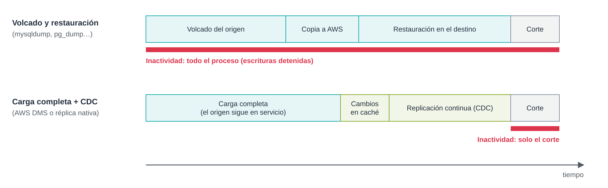

# UD5 · 6.1. Migración de bases de datos: técnicas y planificación

> **Módulo:** 5162 · Administración de bases de datos y almacenamiento en la nube
> **Unidad didáctica:** UD5 · Transferencia, sincronización y migración de datos
> **Temporalización:** semana 2 · sesión 9
> **Resultados de aprendizaje:** RA5 (criterios a, c, e, f, g, h) · RA4 (criterio e)

---

## 1. Introducción

Migrar una base de datos es más delicado que migrar ficheros. Una base de datos cambia constantemente mientras se migra, tiene objetos además de datos (índices, vistas, procedimientos, usuarios) y suele dar servicio a aplicaciones que no pueden quedarse paradas mucho tiempo.

Este documento presenta las técnicas para trasladar una base de datos a AWS y cómo planificar el proceso para que termine con los datos íntegros y el menor tiempo de inactividad posible. El documento 6.2 estudia en detalle AWS Database Migration Service (DMS).

### Objetivos

- Distinguir entre migraciones homogéneas y heterogéneas.
- Conocer las técnicas de migración y el tiempo de inactividad que implica cada una.
- Planificar una migración: evaluación, pruebas, corte y vuelta atrás.
- Validar que los datos migrados coinciden con el origen.

---

## 2. Migración homogénea y heterogénea

| Tipo | Definición | Ejemplo | Dificultad principal |
|---|---|---|---|
| **Homogénea** | El motor de origen y el de destino son el mismo. | MySQL local → Amazon RDS for MySQL | Mover los datos con poca interrupción. |
| **Heterogénea** | El motor cambia. | Oracle → Amazon Aurora PostgreSQL | Además, convertir el esquema y el código (procedimientos, disparadores, tipos de datos). |

En una migración homogénea, el esquema se traslada tal cual. En una heterogénea, hay dos trabajos separados: **convertir el esquema** y **mover los datos**. Conviene que la versión del motor de destino sea igual o superior a la de origen: no se puede migrar a una versión anterior.

Desde el punto de vista de las estrategias de migración (documento 1), pasar de un servidor propio a Amazon RDS con el mismo motor es **Replatform**. Cambiar de motor forma parte habitualmente de un **Refactor**.

---

## 3. Técnicas de migración

### 3.1. Volcado lógico y restauración

Se exporta la base de datos a un fichero de sentencias SQL con las herramientas del propio motor y se ejecuta ese fichero en el destino.

| Motor | Exportación | Importación |
|---|---|---|
| MySQL / MariaDB | `mysqldump` | `mysql` |
| PostgreSQL | `pg_dump` | `pg_restore` o `psql` |
| SQL Server | Asistente de exportación o `bcp` | `sqlcmd` o `bcp` |

```bash
# Volcado coherente de una base de datos InnoDB, con procedimientos, disparadores y eventos
mysqldump -h origen.empresa.local -u admin -p \
    --single-transaction --routines --triggers --events \
    --set-gtid-purged=OFF --databases tienda > tienda.sql

# Restauración en Amazon RDS for MySQL
mysql -h tienda-db.xxxxxxxx.us-east-1.rds.amazonaws.com -u admin -p < tienda.sql
```

- **Ventajas:** sencilla, sin herramientas adicionales, migra datos y objetos.
- **Inconvenientes:** las escrituras deben detenerse desde que empieza el volcado hasta que la aplicación apunta al destino; todo ese tiempo es **inactividad**. Con bases de datos grandes puede durar horas.
- **Cuándo usarla:** bases de datos pequeñas o medianas, o cuando se dispone de una ventana de mantenimiento amplia.

> **Nota.** En Amazon RDS no existe un usuario con privilegio `SUPER`. Si el volcado incluye cláusulas `DEFINER` de otro usuario o sentencias de GTID, la restauración puede fallar. Por eso se usa `--set-gtid-purged=OFF` y se revisan los `DEFINER`.

### 3.2. Copia física

Se copian los ficheros de datos del motor, no sentencias SQL. Es mucho más rápida en volúmenes grandes.

- **MySQL:** se hace una copia con Percona XtraBackup, se sube a S3 y se crea una instancia de RDS restaurándola desde S3.
- **SQL Server:** copia de seguridad nativa (`.bak`) en S3 y restauración en RDS for SQL Server.
- **Oracle:** Oracle Data Pump con los ficheros en S3.

Tiene el mismo inconveniente que el volcado: si la base de datos sigue recibiendo escrituras, esos cambios no llegan al destino. Por eso suele combinarse con la técnica siguiente.

### 3.3. Replicación nativa

Se configura el destino como **réplica** del origen usando el mecanismo de replicación del propio motor. Tras una carga inicial (por volcado o copia física), los cambios se aplican de forma continua hasta el corte.

- **MySQL:** replicación basada en el registro binario (*binlog*). En RDS for MySQL, el destino se configura como réplica de un servidor externo con los procedimientos almacenados `mysql.rds_set_external_source` (en versiones anteriores, `mysql.rds_set_external_master`) y `mysql.rds_start_replication`.
- **PostgreSQL:** replicación lógica con publicaciones (`CREATE PUBLICATION`) en el origen y suscripciones (`CREATE SUBSCRIPTION`) en el destino.

```sql
-- En el destino (RDS for MySQL), tras la carga inicial con mysqldump --source-data=2
CALL mysql.rds_set_external_source('origen.empresa.local', 3306,
     'repl_user', 'contraseña', 'mysql-bin.000042', 154, 1);  -- último parámetro: SSL
CALL mysql.rds_start_replication;
SHOW REPLICA STATUS\G   -- comprobar Seconds_Behind_Source
```

- **Ventajas:** inactividad mínima; usa mecanismos conocidos del motor.
- **Inconvenientes:** solo sirve para migraciones homogéneas; exige red entre origen y destino y conocer bien el motor.

### 3.4. AWS Database Migration Service

AWS DMS es un servicio gestionado que hace la **carga completa** de los datos y, opcionalmente, la **captura de datos de cambios** (CDC, *Change Data Capture*), leyendo los registros de transacciones del origen. Sirve tanto para migraciones homogéneas como heterogéneas y no requiere instalar nada en el origen. Se estudia en el documento 6.2.

### 3.5. Comparativa

La figura compara el tiempo de inactividad de las dos familias de técnicas.



*Figura 1. Con volcado y restauración, la aplicación no puede escribir durante todo el proceso. Con carga completa más CDC, solo durante el corte.*

| Técnica | Homogénea | Heterogénea | Inactividad | Complejidad |
|---|---|---|---|---|
| Volcado lógico y restauración | Sí | No (salvo exportando datos planos) | Todo el proceso | Baja |
| Copia física | Sí | No | Todo el proceso | Media |
| Carga inicial + replicación nativa | Sí | No | Solo el corte | Media-alta |
| AWS DMS (carga completa + CDC) | Sí | Sí | Solo el corte | Media |

---

## 4. Planificación de la migración

### 4.1. Evaluación del origen

Antes de elegir técnica hay que inventariar la base de datos:

- **Motor, versión y edición.** Determinan el destino posible y las técnicas compatibles.
- **Tamaño** de los datos y de las tablas más grandes, y **ritmo de cambios** (transacciones por segundo, volumen de *binlog* diario).
- **Objetos:** tablas sin clave primaria, columnas de tipo LOB (`BLOB`, `TEXT`), procedimientos, disparadores, eventos, vistas.
- **Juego de caracteres y collation**, para evitar problemas con tildes y eñes.
- **Usuarios y permisos** que habrá que recrear en el destino.
- **Dependencias:** aplicaciones, informes o procesos por lotes que se conectan a la base de datos.

Cuando hay muchas bases de datos que evaluar, AWS recomienda **AWS Migration Evaluator** para el inventario y la estimación de costes. La herramienta anterior, DMS Fleet Advisor, dejó de tener soporte el 20 de mayo de 2026.

### 4.2. Diseño del destino

- **Servicio:** Amazon RDS (mismo motor, gestionado) o Amazon Aurora (compatible con MySQL o PostgreSQL, mayor escalabilidad).
- **Dimensionamiento:** clase de instancia, almacenamiento e IOPS a partir del uso actual.
- **Disponibilidad:** Multi-AZ para producción.
- **Red y seguridad:** subredes privadas, grupos de seguridad que solo permitan el tráfico necesario y conectividad con el origen (VPN o AWS Direct Connect).
- **Parámetros:** grupo de parámetros con la misma configuración relevante que el origen (`sql_mode`, zona horaria, juego de caracteres).

### 4.3. Pruebas

Siempre se hace al menos una **migración de prueba** completa antes de la definitiva. Sirve para medir tiempos reales, detectar incompatibilidades y probar la aplicación contra el destino.

### 4.4. Plan de corte

El **corte** (*cutover*) es el momento en que la aplicación deja de usar el origen y pasa al destino. Con carga completa más CDC, los pasos habituales son:

1. Comprobar que la **latencia de replicación** es cercana a cero.
2. **Detener las escrituras** en el origen: parar la aplicación o poner la base de datos en solo lectura.
3. Esperar a que se apliquen los últimos cambios (latencia cero).
4. **Validar** los datos (apartado 5).
5. Cambiar la **cadena de conexión** de la aplicación o el registro DNS hacia el destino.
6. Abrir las escrituras en el destino y **supervisar** errores y rendimiento.

### 4.5. Plan de vuelta atrás

Hay que decidir de antemano qué se hará si el destino falla después del corte:

- Mantener el origen intacto y **en solo lectura** durante un periodo acordado.
- Fijar **criterios objetivos** para volver atrás (por ejemplo, errores de la aplicación o un rendimiento inaceptable).
- Si se necesita volver sin perder los cambios hechos en el destino, configurar una **replicación inversa** del destino al origen.

---

## 5. Validación de los datos

Que la migración termine sin errores no garantiza que los datos sean correctos. La validación combina varias comprobaciones:

| Comprobación | Cómo | Detecta |
|---|---|---|
| Recuento de filas | `SELECT COUNT(*)` por tabla en origen y destino | Filas que faltan o sobran. |
| Sumas de comprobación | `CHECKSUM TABLE` (MySQL) o sumas sobre columnas numéricas | Diferencias de contenido. |
| Muestreo | Comparar registros concretos, incluidos los más recientes | Problemas de codificación o de tipos de datos. |
| Objetos | Comparar el número de índices, vistas, procedimientos y disparadores | Objetos no migrados. |
| Pruebas funcionales | Ejecutar los casos de uso principales de la aplicación | Errores que los datos no muestran. |

AWS DMS incluye además una **validación automática** fila a fila, que se estudia en el documento 6.2.

---

## 6. Seguridad durante la migración

- **Conexiones cifradas** con TLS entre origen, herramienta de migración y destino.
- **Usuario de migración** con los privilegios mínimos (lectura y replicación en el origen), que se elimina al terminar.
- **Credenciales** guardadas en AWS Secrets Manager, no en *scripts* ni en ficheros de configuración.
- **Destino cifrado** en reposo con AWS KMS desde su creación, porque en RDS no se puede activar el cifrado sobre una instancia existente.
- **Ficheros intermedios** (volcados, copias de seguridad) cifrados y eliminados al acabar.

---

## 7. Ideas clave

- En una migración homogénea solo se mueven los datos; en una heterogénea, además, hay que convertir el esquema y el código.
- El volcado y la copia física obligan a detener las escrituras durante todo el proceso; la replicación nativa y DMS con CDC reducen la inactividad al momento del corte.
- Una migración se planifica: evaluación del origen, diseño del destino, migración de prueba, plan de corte y plan de vuelta atrás.
- La validación combina recuentos, sumas de comprobación, muestreo y pruebas funcionales.

## 8. Preguntas de autoevaluación

1. Una tienda en línea con una base de datos MySQL de 400 GB no puede estar parada más de 15 minutos. ¿Qué técnica descartarías y cuál propondrías?
2. ¿Por qué el volcado con `mysqldump` puede fallar al restaurarse en Amazon RDS? ¿Qué opción lo evita?
3. Enumera los pasos del corte y explica qué ocurre si se cambia la cadena de conexión antes de que la latencia de replicación llegue a cero.

---

## Referencias

- AWS. *Importing data into an Amazon RDS for MySQL DB instance*. <https://docs.aws.amazon.com/AmazonRDS/latest/UserGuide/MySQL.Procedural.Importing.html>
- AWS. *Restoring a backup into an Amazon RDS for MySQL DB instance* (Percona XtraBackup desde S3). <https://docs.aws.amazon.com/AmazonRDS/latest/UserGuide/MySQL.Procedural.Importing.html>
- MySQL. *mysqldump — A Database Backup Program*. <https://dev.mysql.com/doc/refman/8.0/en/mysqldump.html>
- PostgreSQL. *Logical Replication*. <https://www.postgresql.org/docs/current/logical-replication.html>
