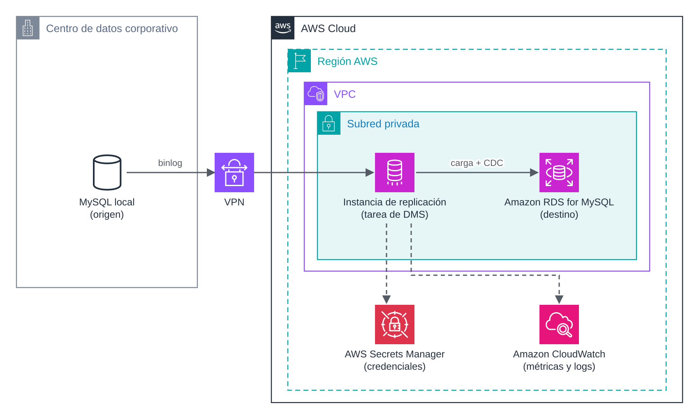
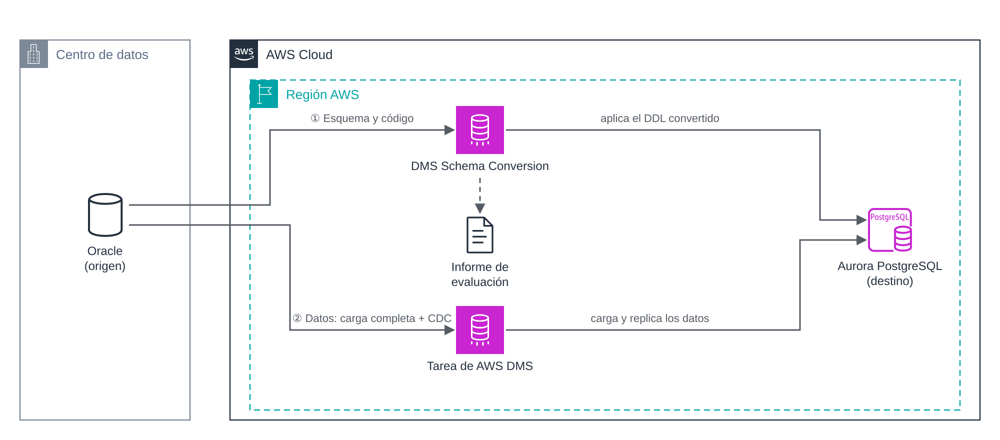

# UD5 · 6.2. AWS Database Migration Service (DMS)

> **Módulo:** 5162 · Administración de bases de datos y almacenamiento en la nube
> **Unidad didáctica:** UD5 · Transferencia, sincronización y migración de datos
> **Temporalización:** semana 2 · sesión 10 (práctica evaluable en las sesiones 11 a 15)
> **Resultados de aprendizaje:** RA5 (criterios a, b, c, e, f, g, h) · RA4 (criterio e) · RA6 (criterios e, g)

---

## 1. Introducción

**AWS Database Migration Service (DMS)** es un servicio gestionado para migrar bases de datos a AWS y replicar datos entre bases de datos. Lee los datos del origen, los transforma si es necesario y los escribe en el destino. Mientras tanto, la base de datos de origen **sigue en servicio**.

Sus usos principales son:

- **Migraciones homogéneas:** MySQL local → Amazon RDS for MySQL.
- **Migraciones heterogéneas:** Oracle → Amazon Aurora PostgreSQL, junto con DMS Schema Conversion.
- **Replicación continua** entre bases de datos, por ejemplo para alimentar un almacén de datos o mantener una copia sincronizada.

### Objetivos

- Identificar los componentes de DMS: instancia de replicación, puntos de enlace y tareas.
- Distinguir los tipos de tarea: carga completa, CDC y carga completa más CDC.
- Preparar una base de datos MySQL como origen de CDC.
- Configurar el mapeo de tablas, la validación y la monitorización de una tarea.
- Conocer las opciones de DMS para migraciones heterogéneas y homogéneas.

---

## 2. Arquitectura



*Figura 1. Migración de MySQL local a Amazon RDS for MySQL. La instancia de replicación lee el origen a través de la VPN y escribe en el destino; las credenciales están en Secrets Manager y la tarea se supervisa con CloudWatch.*

La instancia de replicación se despliega en una **subred privada** de la VPC y necesita conectividad con el origen y con el destino. Cuando el origen está en un centro de datos local, la conexión se hace mediante VPN o AWS Direct Connect.

---

## 3. Componentes

| Componente | Descripción |
|---|---|
| **Instancia de replicación** | Instancia EC2 gestionada por AWS que ejecuta las tareas. Se elige la clase (por ejemplo, `dms.t3.medium`), el almacenamiento, la versión del motor de DMS y si es Multi-AZ. |
| **DMS Serverless** | Alternativa a la instancia: DMS aprovisiona y escala la capacidad automáticamente. Se configura un mínimo y un máximo de **DCU** (*DMS Capacity Units*; 1 DCU = 2 GB de RAM), de 1 a 384. |
| **Punto de enlace de origen** (*source endpoint*) | Datos de conexión a la base de datos de origen: motor, servidor, puerto, usuario y opciones SSL. |
| **Punto de enlace de destino** (*target endpoint*) | Igual, para la base de datos de destino. Puede ser una base de datos, Amazon S3, Amazon Kinesis y otros. |
| **Tarea de migración** (*task*) | Une una instancia, un origen y un destino; define el tipo de migración, qué tablas se migran y cómo. |

Antes de crear una tarea se debe **probar la conexión** de cada punto de enlace desde la instancia de replicación. La mayoría de los errores iniciales son de red (grupos de seguridad, rutas) o de credenciales.

> **Versión del motor de DMS.** A noviembre de 2026, la versión por defecto es la 3.5.4 y la más reciente publicada es la 3.6.1. La versión determina los motores y funciones disponibles.

---

## 4. Tipos de tarea

| Tipo | Qué hace | Cuándo usarlo |
|---|---|---|
| **Carga completa** (*full load*) | Copia los datos existentes en el momento de iniciar la tarea. | Migraciones con ventana de parada o copias puntuales. |
| **Carga completa + CDC** | Copia los datos existentes y después replica los cambios que se producen en el origen. | Migraciones con mínima inactividad. Es el caso más habitual. |
| **Solo CDC** | Replica únicamente los cambios a partir de un momento dado. | Cuando la carga inicial se ha hecho con otra herramienta (por ejemplo, un volcado nativo). |

En una tarea de **carga completa + CDC**, el proceso tiene tres fases:

1. **Carga completa:** DMS copia cada tabla. Los cambios que se producen mientras tanto se guardan en **caché** en la instancia de replicación.
2. **Aplicación de los cambios en caché:** al terminar la carga de cada tabla, DMS aplica los cambios acumulados.
3. **Replicación continua:** DMS lee el registro de transacciones del origen (el *binlog* en MySQL) y aplica cada cambio en el destino hasta que se detiene la tarea.

---

## 5. Preparación del origen para CDC (MySQL)

Para capturar cambios, DMS lee el **registro binario** de MySQL. Por tanto, el origen debe tenerlo activado con un formato concreto.

### 5.1. MySQL autogestionado (local o en EC2)

Parámetros en `my.cnf`:

| Parámetro | Valor requerido |
|---|---|
| `server_id` | 1 o mayor |
| `log-bin` | Ruta del registro binario (activa el *binlog*) |
| `binlog_format` | `ROW` |
| `binlog_row_image` | `FULL` |
| `binlog_expire_logs_seconds` | 86400 (1 día) o más, en MySQL 8.0 y posteriores |
| `binlog_checksum` | `NONE`, solo con versiones de DMS 3.4.7 o anteriores |
| `log_slave_updates` | `TRUE`, si el origen es una réplica de lectura |

```ini
[mysqld]
server_id                  = 1
log-bin                    = /var/log/mysql/mysql-bin
binlog_format              = ROW
binlog_row_image           = FULL
binlog_expire_logs_seconds = 86400
```

### 5.2. Amazon RDS for MySQL como origen

- Activar las **copias de seguridad automáticas**, que habilitan el registro binario.
- En el grupo de parámetros: `binlog_format = ROW` y `binlog_row_image = FULL`. Después, reiniciar la instancia para que todas las sesiones usen el nuevo formato.
- Ampliar la **retención del binlog**, porque RDS lo purga muy pronto:

```sql
CALL mysql.rds_set_configuration('binlog retention hours', 24);
```

### 5.3. Usuario de DMS en el origen

```sql
CREATE USER 'dms_user'@'%' IDENTIFIED BY 'contraseña-segura';
GRANT SELECT ON tienda.* TO 'dms_user'@'%';                         -- carga completa y CDC
GRANT REPLICATION CLIENT, REPLICATION SLAVE ON *.* TO 'dms_user'@'%';  -- solo para CDC
```

### 5.4. Limitaciones relevantes

- **DDL durante el CDC:** se replican `CREATE TABLE`, `ADD COLUMN`, `DROP COLUMN`, cambios de tipo y renombrado de columnas. **No** se replican `DROP TABLE` ni `RENAME TABLE`.
- **Columnas generadas** (`VIRTUAL`, `GENERATED ALWAYS`): sus cambios no se capturan.
- **LOB:** si la tarea no incluye LOB, no se migran las columnas `MEDIUMTEXT`, `LONGTEXT`, `MEDIUMBLOB` ni `LONGBLOB`.
- **Tablas sin clave primaria:** DMS necesita identificar cada fila para aplicar actualizaciones y borrados. Conviene añadir una clave primaria antes de migrar.
- **Ficheros binlog muy grandes** (más de 4 GB) pueden hacer fallar la tarea.

Para PostgreSQL, el equivalente es activar la **replicación lógica**: `wal_level = logical` en un servidor propio, o el parámetro `rds.logical_replication = 1` en Amazon RDS.

---

## 6. Qué migra DMS y qué no

DMS migra **datos**. Al crear las tablas en el destino, solo crea los objetos básicos: tablas, claves primarias y, en algunos casos, índices únicos. **No** migra índices secundarios, claves foráneas, procedimientos, funciones, disparadores, vistas ni usuarios.

Por eso, en una migración homogénea se sigue este orden:

1. Crear el **esquema** en el destino con las herramientas nativas, sin datos: `mysqldump --no-data --routines --triggers`.
2. **Desactivar** temporalmente en el destino las claves foráneas y los disparadores, para que no interfieran con la carga.
3. Ejecutar la tarea de DMS con el modo de preparación `DO_NOTHING` o `TRUNCATE_BEFORE_LOAD`.
4. **Reactivar** las claves foráneas y los disparadores en el momento del corte.

> Un disparador activo en el destino durante el CDC se ejecutaría dos veces: una en el origen, cuyo efecto ya llega replicado, y otra en el destino.

---

## 7. Configuración de la tarea

### 7.1. Mapeo de tablas

El **mapeo de tablas** (*table mappings*) es un documento JSON con reglas de **selección** (qué se migra) y de **transformación** (cambios de nombre, columnas añadidas o eliminadas):

```json
{
  "rules": [
    {
      "rule-type": "selection",
      "rule-id": "1",
      "rule-name": "incluir-tienda",
      "object-locator": { "schema-name": "tienda", "table-name": "%" },
      "rule-action": "include"
    },
    {
      "rule-type": "selection",
      "rule-id": "2",
      "rule-name": "excluir-logs",
      "object-locator": { "schema-name": "tienda", "table-name": "log_%" },
      "rule-action": "exclude"
    },
    {
      "rule-type": "transformation",
      "rule-id": "3",
      "rule-name": "renombrar-esquema",
      "rule-target": "schema",
      "object-locator": { "schema-name": "tienda" },
      "rule-action": "rename",
      "value": "tienda_prod"
    }
  ]
}
```

No conviene usar el comodín `%` como nombre de esquema, porque incluiría los esquemas del sistema y la tarea fallaría en el destino.

### 7.2. Ajustes principales

| Ajuste | Opciones | Recomendación |
|---|---|---|
| **Preparación de las tablas de destino** | `DO_NOTHING`, `DROP_AND_CREATE`, `TRUNCATE_BEFORE_LOAD` | `DO_NOTHING` o `TRUNCATE_BEFORE_LOAD` si el esquema se ha creado antes. |
| **Modo LOB** | No incluir, LOB limitado (tamaño máximo), LOB completo | LOB limitado si se conoce el tamaño máximo: es mucho más rápido. |
| **Validación de datos** | Activada o desactivada | Activada (apartado 8). |
| **Registro** | Registros de la tarea en CloudWatch Logs, con nivel por componente | Activado. |
| **Detener tras la carga completa** | Detener antes o después de aplicar los cambios en caché | Útil para crear índices secundarios antes de iniciar el CDC. |

### 7.3. Evaluación previa

Las **evaluaciones previas a la migración** (*premigration assessments*) analizan la tarea antes de ejecutarla y avisan de problemas: tipos de datos no admitidos, tablas sin clave primaria, LOB o parámetros de CDC incorrectos. Sus resultados se guardan en S3.

---

## 8. Validación de los datos

Con la validación activada, DMS compara **fila a fila** el origen y el destino de cada tabla, tanto después de la carga completa como durante el CDC.

- El resultado se consulta en las **estadísticas de la tabla**: filas validadas, pendientes y fallidas, y el estado de validación (`Validated`, `Mismatched records`, `Pending records`…).
- Las discrepancias se registran en la tabla `awsdms_validation_failures_v1` del destino.
- La validación consume recursos de la instancia y de ambas bases de datos; en tablas muy grandes alarga la migración.

```bash
aws dms describe-table-statistics --replication-task-arn <arn-tarea> \
    --query "TableStatistics[].[TableName,FullLoadRows,Inserts,Updates,Deletes,ValidationState]" \
    --output table
```

---

## 9. Monitorización

| Métrica de CloudWatch | Significado |
|---|---|
| `FullLoadThroughputRowsTarget` | Filas por segundo escritas en el destino durante la carga completa. |
| `CDCLatencySource` | Segundos de retraso entre el último cambio en el origen y su lectura por DMS. |
| `CDCLatencyTarget` | Segundos de retraso entre el cambio en el origen y su aplicación en el destino. Es la métrica que decide el momento del corte. |
| `CDCIncomingChanges` | Cambios recibidos pendientes de aplicar. |
| `CPUUtilization`, `FreeableMemory` | Recursos de la instancia de replicación. |

Además, los **eventos de DMS** (a través de Amazon EventBridge o de suscripciones de eventos) avisan de cambios de estado de la tarea y de fallos.

---

## 10. Migraciones heterogéneas: DMS Schema Conversion

En una migración heterogénea, antes de mover los datos hay que **convertir el esquema y el código** al motor de destino.



*Figura 2. DMS Schema Conversion convierte el esquema y genera un informe de evaluación; una tarea de DMS carga y replica después los datos.*

**DMS Schema Conversion** es una función gestionada de DMS, accesible desde la consola, que:

1. Lee los metadatos del origen y genera un **informe de evaluación** con lo que se convierte automáticamente y lo que requiere trabajo manual.
2. Convierte tablas, vistas, procedimientos, funciones y disparadores al motor de destino.
3. Aplica el código convertido en el destino o lo exporta como *scripts* SQL a Amazon S3.

Usa el motor de conversión de **AWS Schema Conversion Tool (SCT)**, la aplicación de escritorio clásica para esta tarea. Para algunos orígenes (Oracle, SQL Server, Db2, SAP ASE hacia PostgreSQL) ofrece además conversión asistida por **IA generativa** para los objetos que las reglas no convierten. Su uso es gratuito: solo se paga el almacenamiento en S3.

| Origen | Destinos admitidos |
|---|---|
| Oracle | Aurora/RDS PostgreSQL, Aurora/RDS MySQL, Amazon Redshift |
| SQL Server | Aurora/RDS PostgreSQL, Aurora/RDS MySQL |
| PostgreSQL | Aurora/RDS MySQL |
| MySQL | Aurora/RDS PostgreSQL |
| IBM Db2 (LUW y z/OS) | Aurora/RDS PostgreSQL |
| SAP ASE | Aurora/RDS PostgreSQL |

Tanto Schema Conversion como las migraciones homogéneas (apartado 11) se organizan en **proyectos de migración**, formados por un **perfil de instancia** (red y seguridad) y dos **proveedores de datos** (origen y destino).

---

## 11. Migraciones homogéneas de DMS

Para migraciones entre el **mismo motor** hacia Amazon RDS o Aurora (MySQL, PostgreSQL, MongoDB), DMS ofrece las **migraciones de datos homogéneas**. En ellas, DMS usa las **herramientas nativas** del motor en un entorno sin servidor que aprovisiona y escala automáticamente.

- Admite carga completa, replicación continua y ambas.
- Migra también objetos secundarios como funciones y procedimientos.
- No incluye validación de datos integrada.
- En MySQL, las reglas de selección solo se admiten en carga completa.
- Se paga por hora mientras dura la migración, sin cargos de almacenamiento ni de transferencia.

**Cuándo usar cada opción en una migración MySQL → RDS for MySQL:**

| Necesidad | Opción |
|---|---|
| Control fino de tablas, transformaciones y validación | Tarea de DMS clásica (instancia o Serverless) |
| Migrar todo, incluidos procedimientos, con herramientas nativas y sin gestionar capacidad | Migración homogénea de DMS |
| Sin DMS (o si DMS no está disponible) | Volcado inicial + replicación nativa (documento 6.1) |

---

## 12. Costes

| Concepto | Modelo de precio |
|---|---|
| Instancia de replicación | Por hora según la clase, más el almacenamiento adicional. Las instancias T3 incluyen 50 GB. |
| DMS Serverless | Por hora y DCU consumida. |
| Migraciones homogéneas | Por hora mientras dura la migración. |
| DMS Schema Conversion | Gratuito; solo se paga el almacenamiento en S3. |
| Transferencia de datos | Gratuita la entrada a DMS y entre DMS y RDS o EC2 en la misma zona de disponibilidad; tarifa normal entre zonas, regiones o hacia fuera de AWS. |

*Consulta los precios actuales por región en la página de precios de DMS y en la AWS Pricing Calculator.*

El mayor error de coste es **olvidar la instancia de replicación encendida** al terminar. Hay que eliminarla, junto con sus puntos de enlace, cuando la migración ha concluido.

---

## 13. Ejemplo con la AWS CLI

```bash
# 1. Grupo de subredes para la instancia de replicación (subredes privadas)
aws dms create-replication-subnet-group \
    --replication-subnet-group-identifier ud5-dms-subnets \
    --replication-subnet-group-description "Subredes privadas UD5" \
    --subnet-ids subnet-aaaa subnet-bbbb

# 2. Instancia de replicación
aws dms create-replication-instance \
    --replication-instance-identifier ud5-dms \
    --replication-instance-class dms.t3.medium \
    --allocated-storage 50 \
    --replication-subnet-group-identifier ud5-dms-subnets \
    --vpc-security-group-ids sg-dms \
    --no-publicly-accessible

# 3. Puntos de enlace de origen y destino
aws dms create-endpoint --endpoint-identifier ud5-origen --endpoint-type source \
    --engine-name mysql --server-name 10.0.1.25 --port 3306 \
    --username dms_user --password '<contraseña>'
aws dms create-endpoint --endpoint-identifier ud5-destino --endpoint-type target \
    --engine-name mysql --server-name tienda-db.xxxxxxxx.us-east-1.rds.amazonaws.com \
    --port 3306 --username admin --password '<contraseña>' --ssl-mode require

# 4. Probar las conexiones
aws dms test-connection --replication-instance-arn <arn-instancia> --endpoint-arn <arn-origen>
aws dms test-connection --replication-instance-arn <arn-instancia> --endpoint-arn <arn-destino>

# 5. Tarea de carga completa + CDC con el mapeo de tablas del apartado 7.1
aws dms create-replication-task --replication-task-identifier ud5-tienda \
    --source-endpoint-arn <arn-origen> --target-endpoint-arn <arn-destino> \
    --replication-instance-arn <arn-instancia> \
    --migration-type full-load-and-cdc \
    --table-mappings file://mapeo.json \
    --replication-task-settings file://ajustes.json

# 6. Inicio y seguimiento
aws dms start-replication-task --replication-task-arn <arn-tarea> \
    --start-replication-task-type start-replication
aws dms describe-replication-tasks \
    --filters Name=replication-task-arn,Values=<arn-tarea> \
    --query "ReplicationTasks[0].[Status,ReplicationTaskStats.FullLoadProgressPercent]"
```

En un entorno real, en lugar de escribir la contraseña en el comando, el punto de enlace puede leer las credenciales de **AWS Secrets Manager**.

> **En el Learner Lab.** DMS necesita el rol de servicio `dms-vpc-role` para crear la instancia de replicación en la VPC, y en el Learner Lab no se pueden crear roles IAM. Antes de la práctica hay que comprobar si el rol existe en la cuenta del laboratorio. Si no existe, la práctica se hará con la alternativa de volcado inicial más replicación nativa del documento 6.1.

---

## 14. Ideas clave

- DMS se compone de una instancia de replicación (o capacidad sin servidor), dos puntos de enlace y una tarea.
- La tarea de carga completa + CDC permite migrar con el origen en servicio y reduce la inactividad al corte.
- En MySQL, el CDC requiere *binlog* en formato `ROW` con imagen `FULL`, retención suficiente y un usuario con privilegios de replicación.
- DMS migra datos, no objetos secundarios: el esquema completo se crea antes y las claves foráneas y disparadores se activan en el corte.
- La validación fila a fila y las métricas `CDCLatencySource` y `CDCLatencyTarget` indican cuándo es seguro hacer el corte.
- En migraciones heterogéneas, DMS Schema Conversion convierte el esquema y una tarea de DMS mueve los datos.

## 15. Preguntas de autoevaluación

1. Una tarea de DMS en modo carga completa + CDC termina la carga, pero no replica ningún cambio posterior. ¿Qué parámetros del origen revisarías?
2. ¿Por qué hay que desactivar los disparadores del destino mientras la tarea está en CDC?
3. ¿Qué métrica de CloudWatch consultarías para decidir el momento del corte y qué valor esperarías?
4. Una empresa quiere migrar SQL Server a Aurora PostgreSQL. Describe las dos fases del proceso y el servicio que usarías en cada una.

---

## Referencias

- AWS. *What is AWS Database Migration Service?* <https://docs.aws.amazon.com/dms/latest/userguide/Welcome.html>
- AWS. *Using a MySQL-compatible database as a source for AWS DMS*. <https://docs.aws.amazon.com/dms/latest/userguide/CHAP_Source.MySQL.html>
- AWS. *AWS DMS Serverless components*. <https://docs.aws.amazon.com/dms/latest/userguide/CHAP_Serverless.Components.html>
- AWS. *Converting database schemas using DMS Schema Conversion*. <https://docs.aws.amazon.com/dms/latest/userguide/CHAP_SchemaConversion.html>
- AWS. *Migrating databases to their Amazon RDS equivalents with AWS DMS* (migraciones homogéneas). <https://docs.aws.amazon.com/dms/latest/userguide/data-migrations.html>
- AWS. *AWS DMS release notes*. <https://docs.aws.amazon.com/dms/latest/userguide/CHAP_ReleaseNotes.html>
- AWS. *AWS Database Migration Service pricing*. <https://aws.amazon.com/dms/pricing/>
