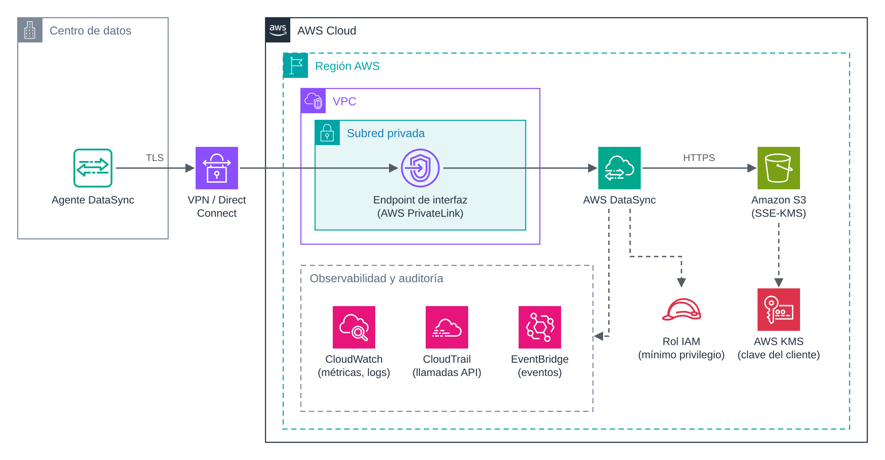

# UD5 · 7. Seguridad, monitorización y auditoría de las transferencias

## 1. Introducción

Una transferencia de datos es uno de los momentos de mayor exposición de la información: los datos salen de su entorno habitual, atraviesan redes y llegan a sistemas nuevos. Por eso, la seguridad y la supervisión no son un añadido final, sino parte del diseño desde el principio.

Este documento reúne, de forma transversal a todos los servicios de la unidad, los mecanismos que garantizan que la información **solo viaja entre los orígenes y destinos autorizados**, que lo hace **cifrada** y que cada operación queda **registrada y supervisada**.

### Objetivos

- Aplicar cifrado en tránsito y en reposo a una transferencia.
- Definir permisos con el principio de mínimo privilegio.
- Establecer conectividad privada con AWS mediante VPN, Direct Connect y *endpoints* de VPC.
- Supervisar las transferencias con CloudWatch y EventBridge, y auditarlas con CloudTrail.

---

## 2. Arquitectura de referencia



*Figura 6. Transferencia privada con AWS DataSync: el agente se conecta mediante VPN o Direct Connect a un endpoint de interfaz de la VPC; los datos se cifran con una clave de KMS y la actividad se registra en CloudWatch, CloudTrail y EventBridge.*

La arquitectura aplica **defensa en profundidad**, con controles en cuatro capas:

| Capa        | Control                                           | Elemento de la figura                          |
| ----------- | ------------------------------------------------- | ---------------------------------------------- |
| Red         | Conectividad privada y sin exposición a Internet. | VPN o Direct Connect y *endpoint* de interfaz. |
| Identidad   | Permisos mínimos para cada servicio.              | Rol IAM.                                       |
| Datos       | Cifrado en tránsito y en reposo.                  | TLS y SSE-KMS.                                 |
| Supervisión | Métricas, eventos y registro de la actividad.     | CloudWatch, EventBridge y CloudTrail.          |

---

## 3. Cifrado

### 3.1. En tránsito

| Servicio             | Mecanismo                                                                  |
| -------------------- | -------------------------------------------------------------------------- |
| AWS CLI y Amazon S3  | HTTPS (TLS).                                                               |
| AWS DataSync         | TLS entre el agente y el servicio.                                         |
| AWS Transfer Family  | SSH (SFTP), TLS (FTPS) o firma y cifrado de mensajes (AS2). FTP no cifra.  |
| Conexión entre redes | IPsec en la VPN; Direct Connect puede reforzarse con VPN o cifrado MACsec. |

Para **impedir cualquier acceso sin cifrar** a un *bucket*, se añade una política que deniega las peticiones que no usan TLS:

```json
{
  "Version": "2012-10-17",
  "Statement": [{
    "Sid": "DenegarSinTLS",
    "Effect": "Deny",
    "Principal": "*",
    "Action": "s3:*",
    "Resource": [
      "arn:aws:s3:::ud5-destino-<iniciales>",
      "arn:aws:s3:::ud5-destino-<iniciales>/*"
    ],
    "Condition": { "Bool": { "aws:SecureTransport": "false" } }
  }]
}
```

### 3.2. En reposo

- **Amazon S3** cifra todos los objetos nuevos por defecto con **SSE-S3** (claves gestionadas por S3).
- Cuando se requiere control sobre las claves, rotación propia o auditoría de su uso, se utiliza **SSE-KMS** con una **clave administrada por el cliente** en AWS KMS. Activar las **claves de bucket** (*S3 Bucket Keys*) reduce el número de llamadas a KMS y, con ello, su coste.
- **Amazon EFS** y **Amazon RDS** permiten activar el cifrado en reposo al crear el recurso.

```bash
# Cifrado por defecto del bucket con una clave de KMS y clave de bucket activada
aws s3api put-bucket-encryption --bucket ud5-destino-<iniciales> \
    --server-side-encryption-configuration '{"Rules":[{"ApplyServerSideEncryptionByDefault":{"SSEAlgorithm":"aws:kms","KMSMasterKeyID":"<arn-clave-kms>"},"BucketKeyEnabled":true}]}'
```

---

## 4. Control de acceso

El principio de **mínimo privilegio** implica que cada servicio y cada usuario reciba solo los permisos imprescindibles:

- **DataSync** accede al *bucket* mediante un rol IAM. Ese rol debe limitarse al *bucket* y al prefijo de destino, y a las acciones necesarias (listar, leer, escribir).
- **Transfer Family** asigna a cada usuario un rol y, opcionalmente, una **política de sesión** que lo restringe a su carpeta.
- Las **políticas de bucket** pueden limitar el acceso a determinados roles, a un *endpoint* de VPC concreto (condición `aws:SourceVpce`) o a conexiones cifradas.
- Las **políticas de clave de KMS** controlan quién puede cifrar y descifrar con cada clave.

> **En el Learner Lab** no se pueden crear roles IAM; se utiliza el rol predefinido `LabRole`, que tiene permisos amplios. En los informes de práctica se pide **describir** qué permisos mínimos tendría el rol en un entorno real.

---

## 5. Conectividad privada

| Mecanismo                                    | Descripción                                                                                   | Uso en la unidad                                                                                |
| -------------------------------------------- | --------------------------------------------------------------------------------------------- | ----------------------------------------------------------------------------------------------- |
| **VPN de sitio a sitio**                     | Túnel IPsec cifrado a través de Internet entre la red local y la VPC.                         | Conexión del centro de datos con AWS.                                                           |
| **AWS Direct Connect**                       | Conexión física dedicada entre la red local y AWS, con ancho de banda y latencia predecibles. | Migraciones grandes y flujos híbridos permanentes.                                              |
| ***Endpoint* de puerta de enlace para S3**   | Permite que los recursos de la VPC accedan a S3 sin salir a Internet. Sin coste adicional.    | Acceso privado de instancias EC2 a S3.                                                          |
| ***Endpoint* de interfaz (AWS PrivateLink)** | Interfaz de red con IP privada en una subred, que da acceso privado a la API de un servicio.  | DataSync con *endpoint* de VPC.                                                                 |
| **Grupos de seguridad**                      | Cortafuegos con estado aplicado a las interfaces de red.                                      | Restringir el tráfico al destino de montaje de EFS o a las IP de cada socio en Transfer Family. |

La combinación de **VPN o Direct Connect** con un ***endpoint* de interfaz** garantiza que los datos viajan desde el origen hasta el servicio sin pasar por Internet.

---

## 6. Monitorización

### 6.1. Métricas y registros

| Servicio            | Métricas principales en CloudWatch                                               | Registros                                             |
| ------------------- | -------------------------------------------------------------------------------- | ----------------------------------------------------- |
| AWS DataSync        | Bytes y ficheros preparados, transferidos y verificados.                         | CloudWatch Logs e informes de tarea en S3.            |
| AWS Transfer Family | Bytes y ficheros de entrada y salida; ejecuciones de flujos.                     | Registros estructurados de sesión en CloudWatch Logs. |
| Amazon S3           | Tamaño del *bucket*, número de objetos y, opcionalmente, métricas de peticiones. | Registros de acceso al servidor.                      |

Sobre estas métricas se definen **alarmas de CloudWatch**, por ejemplo cuando no se ha transferido ningún byte en el periodo esperado.

### 6.2. Eventos y notificaciones

**Amazon EventBridge** recibe los cambios de estado de los servicios y permite reaccionar ante ellos. La siguiente regla detecta las ejecuciones de DataSync que terminan con error, para enviarlas, por ejemplo, a un tema de Amazon SNS que notifique por correo electrónico:

```json
{
  "source": ["aws.datasync"],
  "detail-type": ["DataSync Task Execution State Change"],
  "detail": { "State": ["ERROR"] }
}
```

---

## 7. Auditoría

- **AWS CloudTrail** registra las llamadas a la API de AWS: quién creó o modificó una tarea de DataSync, un usuario de Transfer Family o una política de *bucket*, cuándo y desde dónde. Por defecto registra los **eventos de administración**; los **eventos de datos** de S3 (lectura y escritura de objetos) deben activarse expresamente.
- Los **informes de tarea de DataSync** y los **registros de Transfer Family** documentan qué ficheros se transfirieron, por quién y con qué resultado.
- Los **registros de acceso al servidor de S3** recogen cada petición recibida por el *bucket*.

Estos registros constituyen la **evidencia** de que la transferencia se ha realizado únicamente entre los orígenes y destinos especificados, tal como exigen los criterios RA5.e y RA6.d.

---

## 8. Lista de comprobación

| Control                                                                                      | Comprobado |
| -------------------------------------------------------------------------------------------- | ---------- |
| Los datos viajan cifrados (TLS, SSH o IPsec).                                                | ☐          |
| El destino cifra los datos en reposo (SSE-S3 o SSE-KMS).                                     | ☐          |
| El *bucket* deniega las peticiones sin TLS y bloquea el acceso público.                      | ☐          |
| Los roles y usuarios tienen solo los permisos necesarios.                                    | ☐          |
| El tráfico no atraviesa Internet cuando el caso lo exige (VPN, Direct Connect, *endpoints*). | ☐          |
| Las métricas y registros de cada transferencia se envían a CloudWatch.                       | ☐          |
| Existe una notificación ante errores (EventBridge y SNS).                                    | ☐          |
| CloudTrail registra la actividad sobre los recursos implicados.                              | ☐          |
| La integridad final se ha verificado con recuentos y sumas de comprobación.                  | ☐          |

---

## 9. Ideas clave

- La seguridad de una transferencia se diseña por capas: red, identidad, datos y supervisión.
- El cifrado en tránsito puede imponerse con políticas de *bucket*; el cifrado en reposo está activo por defecto en S3 y puede reforzarse con KMS.
- Los roles IAM y las políticas de sesión aplican el mínimo privilegio a los servicios y a los usuarios.
- VPN, Direct Connect y los *endpoints* de VPC permiten transferencias sin exposición a Internet.
- CloudWatch y EventBridge supervisan las transferencias; CloudTrail y los registros de cada servicio las auditan.

## 10. Preguntas de autoevaluación

1. ¿Qué diferencia hay entre un *endpoint* de puerta de enlace y un *endpoint* de interfaz?
2. ¿Por qué no basta con el cifrado por defecto SSE-S3 si la organización necesita auditar cada uso de la clave de cifrado?
3. Diseña una regla de EventBridge que avise cuando una ejecución de DataSync termina correctamente. ¿Qué cambiarías respecto a la del apartado 6.2?

---

## Referencias

- AWS. *Protecting data with encryption* (Amazon S3 User Guide). <https://docs.aws.amazon.com/AmazonS3/latest/userguide/UsingEncryption.html>
- AWS. *What is AWS DataSync?* <https://docs.aws.amazon.com/datasync/latest/userguide/what-is-datasync.html>
- AWS. *What is AWS Transfer Family?* <https://docs.aws.amazon.com/transfer/latest/userguide/what-is-aws-transfer-family.html>
- AWS. *What is AWS CloudTrail?* <https://docs.aws.amazon.com/awscloudtrail/latest/userguide/cloudtrail-user-guide.html>
