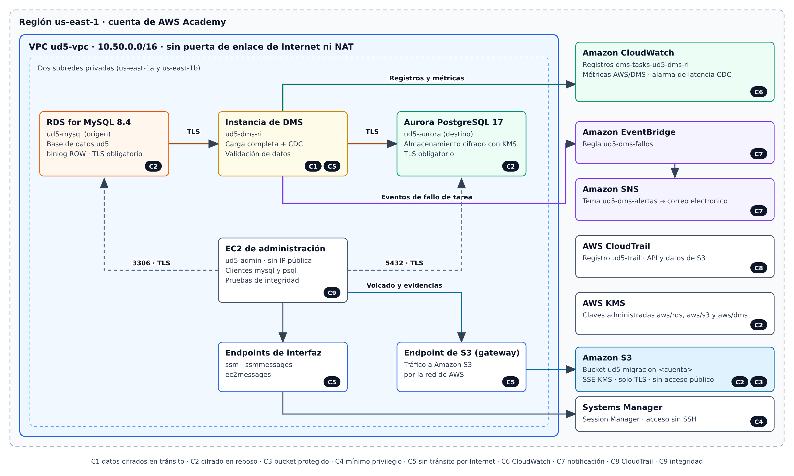

# Práctica guiada: migración de MySQL a Aurora PostgreSQL con AWS DMS

- **Módulo:** Administración de bases de datos y almacenamiento en la nube
- **Curso de especialización:** Recursos y Servicios en la Nube
- **Plataforma:** AWS Academy Learner Lab · Consola de administración de AWS
- **Duración estimada:** 3 horas y 30 minutos, de las que aproximadamente 45 minutos corresponden a tiempos de aprovisionamiento

## 1. Introducción

Una migración heterogénea traslada datos entre motores distintos y exige resolver tres cuestiones: la conversión del esquema, el traslado de los datos y la demostración de que el resultado es íntegro. En esta práctica se migra la base de datos `ud5`, almacenada en MySQL 8.4, a un clúster de Amazon Aurora compatible con PostgreSQL mediante AWS Database Migration Service (DMS).

La migración combina una **carga completa** con la **captura de datos de cambios** (CDC), de modo que el origen puede seguir admitiendo escrituras hasta el momento de la conmutación. Todo el proceso se realiza en una red privada y debe satisfacer la lista de comprobación de seguridad y operación incluida en el apartado 7.

!!! danger
    
    Esta práctica no se puede realizar. Se ha intentado eliminar la necesidad de servicios y permisos al mínimo pero aún así llegamos a varios puntos en los que necesitamos permisos que son imposibles de un obtener en un LearnerLab y que hacen que la práctica sea irrealizable en este entorno.
    
    - En el paso 7 no podemos crear la notificación de errores por falta de permisos.
    - En el paso 15 da un error al generar el grupos de subredes DMS necesario para comenzar el trabajo. 

## 2. Objetivos

Al finalizar la práctica, el alumnado será capaz de:

1. Desplegar una red privada para una migración sin tránsito por Internet.
2. Preparar MySQL y PostgreSQL con usuarios de privilegios mínimos.
3. Configurar y ejecutar una tarea de DMS con carga completa, CDC y validación.
4. Migrar manualmente los objetos que DMS no traslada.
5. Supervisar y auditar la migración con CloudWatch, EventBridge, SNS y CloudTrail.
6. Verificar la integridad final mediante recuentos y sumas de comprobación.

## 3. Requisitos previos

- Acceso a un AWS Academy Learner Lab iniciado, con crédito suficiente.
- Región **us-east-1 (N. Virginia)** en todos los pasos.
- Una dirección de correo electrónico accesible para confirmar la suscripción de SNS.
- El archivo `00-ud5.sql` y la carpeta `scripts/` que acompaña a este enunciado.

> **Advertencia:** inicie la práctica con la sesión del laboratorio recién renovada. Si la sesión expira durante la replicación, los recursos pueden detenerse y será necesario reanudar o reiniciar la tarea.

Los nombres de los elementos de la consola se indican en inglés porque las traducciones pueden variar. Las contraseñas deben contener solo letras y números; no las incluya en la memoria.

## 4. Base de datos de origen

El volcado contiene 9 tablas InnoDB y 2.142 filas, sin vistas, disparadores ni rutinas.

| Tabla                | Filas | Particularidad para la migración                |
| -------------------- | -----:| ----------------------------------------------- |
| `aux_countries`      | 246   | `INT UNSIGNED` y `AUTO_INCREMENT`               |
| `aux_rol`            | 3     | Texto con caracteres no ASCII y saltos de línea |
| `aux_rol_trabajador` | 6     | `AUTO_INCREMENT`                                |
| `categoria`          | 15    | Clave ajena reflexiva                           |
| `log`                | 3     | Clave primaria compuesta                        |
| `producto`           | 1.023 | `INT UNSIGNED`, `DECIMAL` y clave `UNIQUE`      |
| `proveedor`          | 101   | Clave primaria `VARCHAR`                        |
| `trabajadores`       | 742   | `TINYINT(1)` y columnas con mayúsculas          |
| `usuario_sistema`    | 3     | `DATETIME` y clave `UNIQUE`                     |

DMS traslada datos, pero no replica por sí mismo todo el modelo relacional: no migra el atributo `AUTO_INCREMENT` y tampoco garantiza el orden de carga de las tablas. Por ello, se seguirá esta estrategia:

| Momento                   | Objetos                                       | Responsable                         |
| ------------------------- | --------------------------------------------- | ----------------------------------- |
| Antes de la carga         | Esquema, tablas y claves primarias            | `02-destino-esquema.sql`            |
| Durante la carga          | Filas y cambios                               | Tarea de DMS en modo **Do nothing** |
| Después de la conmutación | `UNIQUE`, índices, claves ajenas y secuencias | `03-destino-postcarga.sql`          |

Se opta por un script revisable, en lugar de DMS Schema Conversion, porque esta función no incluye MySQL 8.4 entre sus orígenes documentados y necesita roles adicionales que no pueden crearse con normalidad en el laboratorio.

## 5. Arquitectura



**Figura 1.** Arquitectura final. Las etiquetas C1 a C9 remiten a los controles de la lista de comprobación.

## 6. Interpretación de la lista de comprobación en esta arquitectura

| Control                   | Aplicación en la práctica                                                                                                                    |
| ------------------------- | -------------------------------------------------------------------------------------------------------------------------------------------- |
| Cifrado en tránsito       | TLS con validación del certificado (`verify-full`) en ambos endpoints de DMS.                                                                |
| Cifrado en reposo         | SSE-S3 y SSE-KMS son modalidades propias de Amazon S3. El destino Aurora usa cifrado de almacenamiento con KMS; el bucket usa SSE-KMS.       |
| Bucket protegido          | El bucket del proyecto y el de CloudTrail rechazan peticiones sin TLS y bloquean el acceso público.                                          |
| Mínimo privilegio         | Se aplica a usuarios de base de datos, grupos de seguridad y roles de servicio de DMS. `LabRole` se analiza como limitación del laboratorio. |
| Sin tránsito por Internet | La VPC no tiene puerta de enlace de Internet ni NAT. El acceso a S3 y Systems Manager se realiza mediante endpoints de VPC.                  |

---

## Parte I. Red privada

### Paso 1. Comprobar los roles de DMS

1. Abra **IAM > Roles** y busque `dms-vpc-role` y `dms-cloudwatch-logs-role`.
2. Si faltan, cree cada rol mediante **Create role > AWS service > DMS** y adjunte, respectivamente, `AmazonDMSVPCManagementRole` y `AmazonDMSCloudWatchLogsRole`.
3. Si IAM deniega la operación, continúe con los pasos siguientes: la consola de DMS puede intentar crearlos. Si tampoco lo consigue, comuníquelo al profesorado antes de crear recursos de coste elevado.

> Estos roles deben conservar exactamente esos nombres, porque DMS los busca por nombre.

Este paso no funciona

### Paso 2. Crear la VPC

1. Abra **VPC > Create VPC > VPC and more** y configure:

| Parámetro                      | Valor          |
| ------------------------------ | -------------- |
| Name tag auto-generation       | `ud5`          |
| IPv4 CIDR block                | `10.50.0.0/16` |
| Availability Zones             | 2              |
| Public subnets                 | 0              |
| Private subnets                | 2              |
| NAT gateways                   | None           |
| VPC endpoints                  | **S3 Gateway** |
| DNS hostnames y DNS resolution | Activados      |

2. Cree la VPC y compruebe, en **Your VPCs > Resource map**, que dispone de dos subredes privadas y ninguna puerta de enlace de Internet.
3. Renombre la VPC a `ud5-vpc` si la consola le ha asignado otro nombre.

### Paso 3. Crear los grupos de seguridad

En **VPC > Security groups**, cree estos grupos en `ud5-vpc`. Cree primero `ud5-admin-sg` y `ud5-dms-sg`, ya que los demás hacen referencia a ellos.

| Grupo              | Regla de entrada | Origen                        |
| ------------------ | ---------------- | ----------------------------- |
| `ud5-admin-sg`     | Ninguna          | —                             |
| `ud5-dms-sg`       | Ninguna          | —                             |
| `ud5-mysql-sg`     | TCP 3306         | `ud5-admin-sg` y `ud5-dms-sg` |
| `ud5-aurora-sg`    | TCP 5432         | `ud5-admin-sg` y `ud5-dms-sg` |
| `ud5-endpoints-sg` | TCP 443          | `ud5-admin-sg`                |

### Paso 4. Crear los endpoints de interfaz

Cree tres endpoints en **VPC > Endpoints > Create endpoint**, con **AWS services**, la VPC `ud5-vpc`, ambas subredes, el grupo `ud5-endpoints-sg` y **Enable DNS name** activado:

- `com.amazonaws.us-east-1.ssm`
- `com.amazonaws.us-east-1.ssmmessages`
- `com.amazonaws.us-east-1.ec2messages`

Espere a que todos alcancen el estado **Available**.

## Parte II. Almacenamiento, auditoría y alertas

### Paso 5. Crear y proteger el bucket

1. Obtenga el identificador de la cuenta en el menú superior derecho.
2. En **S3 > Create bucket**, cree `ud5-migracion-<id-cuenta>` con estos valores:

| Parámetro               | Valor                                      |
| ----------------------- | ------------------------------------------ |
| Bucket type             | General purpose                            |
| Object Ownership        | ACLs disabled                              |
| Block all public access | Activado                                   |
| Bucket Versioning       | Enable                                     |
| Default encryption      | SSE-KMS con la clave administrada `aws/s3` |
| Bucket Key              | Enable                                     |

3. En **Permissions > Bucket policy**, pegue la política siguiente, sustituyendo `NOMBRE_DEL_BUCKET`:

```json
{
  "Version": "2012-10-17",
  "Statement": [
    {
      "Sid": "DenegarTransporteSinTLS",
      "Effect": "Deny",
      "Principal": "*",
      "Action": "s3:*",
      "Resource": [
        "arn:aws:s3:::NOMBRE_DEL_BUCKET",
        "arn:aws:s3:::NOMBRE_DEL_BUCKET/*"
      ],
      "Condition": {
        "Bool": { "aws:SecureTransport": "false" }
      }
    }
  ]
}
```

4. Descargue en su equipo el paquete de certificados de la región: `https://truststore.pki.rds.amazonaws.com/us-east-1/us-east-1-bundle.pem`.
5. Suba al bucket `00-ud5.sql` y `us-east-1-bundle.pem` bajo el prefijo `entrada/`, y el contenido de `scripts/` bajo el prefijo `scripts/`.

### Paso 6. Activar CloudTrail

1. Abra **CloudTrail > Trails > Create trail** y configure:

| Parámetro                   | Valor                                                      |
| --------------------------- | ---------------------------------------------------------- |
| Trail name                  | `ud5-trail`                                                |
| Storage location            | Create new S3 bucket                                       |
| Log file SSE-KMS encryption | Desactivado (el bucket conserva su cifrado predeterminado) |
| Log file validation         | Enabled                                                    |
| *CloudWatch Logs*           | Desactivado                                                |
| *Log events*                | Management events y Data events                            |
| *API activity*              | Read y Write                                               |
| Registro recursivo          | Deshabilitadao                                             |
| Entrega de notificación SNS | Deshabilitado                                              |

2. En **Data events**, seleccione **S3**, use una plantilla personalizada y limite el registro a `resources.ARN` que empiece por `arn:aws:s3:::ud5-migracion-<id-cuenta>/`.
3. Cree el registro. A continuación, en el bucket que ha creado CloudTrail, compruebe que **Block all public access** está activado y **añada** la instrucción `DenegarTransporteSinTLS` a la política existente, sin eliminar las instrucciones de CloudTrail.

> Si el laboratorio no permite crear el registro, conserve como evidencia **Event history**, que registra los eventos de administración sin necesidad de un registro de seguimiento, y anote la limitación en la memoria.

### Paso 7. Crear la notificación de errores

1. En **SNS > Topics**, cree el tema estándar `ud5-dms-alertas`.
2. Cree una suscripción **Email** y confírmela desde su correo.
3. En **Access policy**, añada esta instrucción a la lista `Statement`, sustituyendo el ARN del tema:

```json
{
  "Sid": "PermitirEventBridge",
  "Effect": "Allow",
  "Principal": { "Service": "events.amazonaws.com" },
  "Action": "sns:Publish",
  "Resource": "ARN_DEL_TEMA"
}
```

4. En **EventBridge > Buses de eventos > default>  Rules > Create rule**, cree `ud5-dms-fallos` en el bus `default`, de tipo **Rule with an event pattern**, con este patrón personalizado:

```json
{
  "source": ["aws.dms"],
  "detail-type": ["DMS Replication Task State Change"],
  "detail": {
    "category": ["Failure"]
  }
}
```

5. Seleccione como destino el tema `ud5-dms-alertas` y cree la regla.

Falla por falta de permisos

## Parte III. Bases de datos

### Paso 8. Crear el grupo de subredes y los parámetros de MySQL

1. En **RDS > Subnet groups**, cree `ud5-db-subnets` en `ud5-vpc` con las dos subredes privadas.
2. En **RDS > Parameter groups**, cree `ud5-mysql84-params`, con motor MySQL Community y familia `mysql8.4`.
3. Edite el grupo y establezca:

| Parámetro                  | Valor  | Finalidad                     |
| -------------------------- | ------ | ----------------------------- |
| `binlog_format`            | `ROW`  | Captura de cambios por DMS    |
| `binlog_row_image`         | `full` | Imagen completa de cada fila  |
| `require_secure_transport` | `1`    | Rechazo de conexiones sin TLS |

### Paso 9. Crear la instancia de origen

En **RDS > Databases > Create database**, elija **Full configuration** y **MySQL**:

| Parámetro              | Valor                                          |
| ---------------------- | ---------------------------------------------- |
| Engine version         | MySQL 8.4 (última versión secundaria ofrecida) |
| Template               | Dev/Test                                       |
| Deployment             | Single-AZ, una instancia                       |
| DB instance identifier | `ud5-mysql`                                    |
| Master username        | `admin`                                        |
| Credentials            | Self managed                                   |
| Instance class         | `db.t3.small`                                  |
| Storage                | General Purpose, 20 GiB, sin autoescalado      |
| VPC y DB subnet group  | `ud5-vpc` y `ud5-db-subnets`                   |
| Public access          | No                                             |
| VPC security group     | `ud5-mysql-sg` (retire `default`)              |
| Initial database name  | `ud5`                                          |
| DB parameter group     | `ud5-mysql84-params`                           |
| Automated backups      | Activados, retención de 1 día                  |
| Encryption             | Activado, clave `aws/rds`                      |
| Enhanced Monitoring    | Desactivado                                    |
| Deletion protection    | Desactivado                                    |

> Las copias de seguridad automáticas no son opcionales: en RDS for MySQL activan el registro binario que necesita CDC.

### Paso 10. Crear el clúster de destino

En **Create database**, elija **Aurora (PostgreSQL Compatible)**:

| Parámetro                                  | Valor                                   |
| ------------------------------------------ | --------------------------------------- |
| Engine version                             | Aurora PostgreSQL 17 (17.4 o posterior) |
| Template                                   | Dev/Test                                |
| DB cluster identifier                      | `ud5-aurora`                            |
| Master username                            | `adminud5`                              |
| Credentials                                | Self managed                            |
| Cluster storage                            | Aurora Standard                         |
| Instance class                             | Burstable, `db.t3.medium`               |
| Aurora Replica                             | No crear                                |
| VPC y DB subnet group                      | `ud5-vpc` y `ud5-db-subnets`            |
| Public access                              | No                                      |
| VPC security group                         | `ud5-aurora-sg` (retire `default`)      |
| Initial database name                      | `ud5`                                   |
| Encryption                                 | Activado, clave `aws/rds`               |
| Enhanced Monitoring y Performance Insights | Desactivados                            |
| Deletion protection                        | Desactivado                             |

Anote el **writer endpoint** del clúster y el endpoint de `ud5-mysql`.

### Paso 11. Crear la instancia de administración

1. En **EC2 > Launch instance**, cree `ud5-admin` con **Amazon Linux 2023**, tipo `t3.micro` y par de claves vockey.
2. En la configuración de red, seleccione `ud5-vpc`, una subred privada, **Auto-assign public IP: Disable** y el grupo `ud5-admin-sg`.
3. En **Advanced details > IAM instance profile**, elija `LabInstanceProfile`.
4. Cuando la instancia supere las comprobaciones, conéctese con **Connect > Session Manager**.
5. Ejecute, los siguientes comandos sustituyendo los valores entre ángulos:

```bash
sudo -iu ec2-user

cat >> ~/.bashrc <<'FIN'
export AWS_DEFAULT_REGION=us-east-1
export BUCKET=ud5-migracion-<id-cuenta>
export MYSQL_HOST=<endpoint-de-ud5-mysql>
export AURORA_HOST=<writer-endpoint-de-ud5-aurora>
export CA=$HOME/ud5/us-east-1-bundle.pem
alias my='mysql -h $MYSQL_HOST -u admin -p --ssl-ca=$CA --ssl-verify-server-cert --default-character-set=utf8mb4'
alias pg='psql "host=$AURORA_HOST port=5432 dbname=ud5 user=adminud5 sslmode=verify-full sslrootcert=$CA"'
FIN

source ~/.bashrc

sudo dnf install -y mariadb105 postgresql17
mkdir -p ~/ud5/evidencias && cd ~/ud5
aws s3 cp s3://$BUCKET/entrada/ . --recursive
aws s3 cp s3://$BUCKET/scripts/ . --recursive
```

> Si `postgresql17` no está disponible, consulte `dnf list 'postgresql1*'` e instale la versión más reciente. La instalación funciona sin NAT porque los repositorios de Amazon Linux 2023 se sirven desde S3, accesible por el endpoint de puerta de enlace.

!!! tip

    Si al ejecutar `source ~/.bashrc` tenemos un error de sintaxis o no se generan las variables, tendremos que editar manualmente el fichero `~/.bashrc`
    ```bash
    nano ~/.bashrc
    ```
    e insertar las variables manualmente al final del fichero.

6. Compruebe el aislamiento de la red y la protección del bucket:

```bash
curl -m 5 -I https://aws.amazon.com
aws s3 ls s3://$BUCKET --endpoint-url http://s3.us-east-1.amazonaws.com
```

El primer comando debe agotar el tiempo de espera, y el segundo debe devolver `AccessDenied`.

### Paso 12. Cargar y preparar el origen

Vamos a crear un usuario en `mysql` para migrar los datos. Para ello primero crearemos una variable de sesión llamada `CLAVE_DMS` que será la clave de acceso del usuario creado. Puedes ver los comandos que se ejecutan si revisas el fichero `00-fuente-usuario-dms.sql`

Ejecute este paso y los siguientes desde `~/ud5`, en la misma sesión si es posible, ya que `CLAVE_DMS` no se conserva entre sesiones.

=== "Comandos bash"
    ```bash
    my ud5 < 00-ud5.sql
    echo "Vamos a establecer la clave para hacer las migraciones DMS"
    read -rs CLAVE_DMS; echo
    sed "s/<CLAVE_DMS>/$CLAVE_DMS/" 00-fuente-usuario-dms.sql | my
    ```

=== "Fichero 00-fuente-usuario-dms.sql"
    ```sql
    -- =====================================================================
    -- 00-fuente-usuario-dms.sql
    -- Se ejecuta en RDS for MySQL como admin. Sustituya <CLAVE_DMS>.
    -- =====================================================================
    CREATE USER 'dms_user'@'10.50.%' IDENTIFIED BY '<CLAVE_DMS>' REQUIRE SSL;

    GRANT SELECT ON ud5.* TO 'dms_user'@'10.50.%';                 -- carga completa
    GRANT REPLICATION CLIENT, REPLICATION SLAVE ON *.* TO 'dms_user'@'10.50.%';   --         CDC
    
    -- Conserva los registros binarios durante 24 horas para la replicación.
    CALL mysql.rds_set_configuration('binlog retention hours', 24);
    CALL mysql.rds_show_configuration;
    ```

!!! note

    Recuerda que `my` es un comando que creamos en el paso 11 que equivale a:
    
    ```bash
    mysql -h $MYSQL_HOST -u admin -p --ssl-ca=$CA --ssl-verify-server-cert --default-character-set=utf8mb4
    ```
    Hemos creado un comando similar para postgres que se llama `pg`

La cuenta `dms_user` solo se admite desde la VPC y exige TLS. Sus privilegios son los mínimos necesarios:

| Privilegio                                 | Justificación                         |
| ------------------------------------------ | ------------------------------------- |
| `SELECT` sobre `ud5.*`                     | Lectura de la carga completa          |
| `REPLICATION CLIENT` y `REPLICATION SLAVE` | Lectura del registro binario para CDC |

Cada ejecución de `my` y `pg` solicita la contraseña correspondiente.

### Paso 13. Preparar el destino

Vamos a preparar el destino postgres y a crear las tablas en el esquema destino.

=== "Comandos bash"

    ```bash
    pg -v clave_dms="$CLAVE_DMS" -f 01-destino-preparacion.sql
    pg -f 02-destino-esquema.sql
    pg -c "SELECT ssl, version FROM pg_stat_ssl WHERE pid = pg_backend_pid();"
    ```

=== "01-destino-preparacion.sql"

    ```sql
    -- =====================================================================
    -- 01-destino-preparacion.sql
    -- Se ejecuta en Aurora PostgreSQL, base de datos ud5, como adminud5.
    -- Sustituya :'clave_dms' mediante psql -v (véase el enunciado).
    -- =====================================================================
    CREATE SCHEMA IF NOT EXISTS ud5 AUTHORIZATION adminud5;
    
    CREATE ROLE dms_target LOGIN PASSWORD :'clave_dms';
    
    -- Permisos mínimos de DMS sobre el destino.
    GRANT CONNECT ON DATABASE ud5 TO dms_target;
    GRANT CREATE ON DATABASE ud5 TO dms_target;   -- esquema de control awsdms_control
    GRANT USAGE, CREATE ON SCHEMA ud5 TO dms_target;
    
    -- Permite a adminud5 consultar el esquema awsdms_control, propiedad de dms_target.
    GRANT dms_target TO adminud5;
    ```

La sesión debe indicar `ssl = t`. El destino usa `BIGINT` para `INT UNSIGNED`, porque el rango de un `INTEGER` de PostgreSQL es insuficiente, y `SMALLINT` para `TINYINT(1)`, con objeto de conservar valores idénticos durante la validación.

Ahora vamos a comprobar que el sistema rechaza las conexiones sin ssl:

```sql
psql "host=$AURORA_HOST port=5432 dbname=ud5 user=adminud5 sslmode=disable" -c "SELECT 1;"
```

El resultado debería ser un error FATAL similar a este:

```sql
FATAL:  no pg_hba.conf entry for host "...", user "adminud5", database "ud5", no encryption
```

!!! info

    En esta práctica utilizamos el script `02-destino-esquema` para generar las tablas destino en el sistema Aurora Postgres. 
    
    En un entorno real podríamos usar `DMS Schema Conversion` para convertir el esquema `MySQL` a un esquema `Aurora Postgres`. 
    
    En esta práctica no usaremos esta herramienta porque necesitaríamos un perfil de instancia, proveedores de datos, un proyecto de migración y credenciales en Secrets Manager, además de sus permisos. Lo cual añade una dependencia de ciertos roles de los que no disponemos en un Learner Lab.

### Paso 14. Registrar la línea base

```bash
my -N -B ud5 < 04-integridad-mysql.sql | LC_ALL=C sort > evidencias/base-mysql.tsv
cat evidencias/base-mysql.tsv
```

El resultado debe mostrar las 9 tablas y los recuentos del apartado 4.

## Parte IV. Configuración de DMS

### Paso 15. Crear los recursos de replicación

1. En **DMS > Subnet groups**, cree `ud5-dms-subnets` en `ud5-vpc` con ambas subredes.
2. En **Provisioned instances**, cree la instancia:

| Parámetro                | Valor                                       |
| ------------------------ | ------------------------------------------- |
| Name                     | `ud5-dms-ri`                                |
| Instance class           | `dms.t3.medium`                             |
| Engine version           | La predeterminada, siempre 3.5.4 o superior |
| High Availability        | Dev or test workload (Single-AZ)            |
| Allocated storage        | 50 GiB                                      |
| Replication subnet group | `ud5-dms-subnets`                           |
| Public accessible        | Desactivado                                 |
| VPC security group       | `ud5-dms-sg`                                |
| AWS KMS key              | `aws/dms`                                   |

3. En **Certificates > Import certificate**, importe `us-east-1-bundle.pem` con el identificador `rds-us-east-1`.

### Paso 16. Crear los endpoints

Cree dos endpoints en **DMS > Endpoints**:

| Parámetro                      | Origen                              | Destino                             |
| ------------------------------ | ----------------------------------- | ----------------------------------- |
| Endpoint type                  | Source endpoint                     | Target endpoint                     |
| Endpoint identifier            | `ud5-fuente-mysql`                  | `ud5-destino-aurora`                |
| Source/Target engine           | MySQL                               | Amazon Aurora PostgreSQL            |
| Access to endpoint database    | Provide access information manually | Provide access information manually |
| Server name                    | Endpoint de `ud5-mysql`             | Writer endpoint de `ud5-aurora`     |
| Port                           | 3306                                | 5432                                |
| Secure Socket Layer (SSL) mode | `verify-full`                       | `verify-full`                       |
| CA certificate                 | `rds-us-east-1`                     | `rds-us-east-1`                     |
| User name                      | `dms_user`                          | `dms_target`                        |
| Database name                  | —                                   | `ud5`                               |

Antes de guardar cada endpoint, ejecute **Test endpoint connection** con `ud5-dms-ri`. Ambas pruebas deben finalizar como **successful**.

### Paso 17. Probar la notificación de errores

Se creará una tarea que falla deliberadamente al no encontrar ninguna tabla.

1. En **Database migration tasks > Create task**, configure `ud5-prueba-fallo` con la instancia y los endpoints anteriores, **Migrate existing data** y **Do nothing**.
2. En **Table mappings**, abra el editor JSON y pegue:

```json
{
  "rules": [
    {
      "rule-type": "selection",
      "rule-id": "1",
      "rule-name": "tabla-inexistente",
      "object-locator": { "schema-name": "ud5", "table-name": "tabla_inexistente" },
      "rule-action": "include"
    }
  ]
}
```

3. Inicie la tarea y espere a que su estado sea **Failed**.
4. Compruebe la llegada del correo de SNS, conserve la captura y elimine la tarea.

## Parte V. Migración

### Paso 18. Crear la tarea principal

Cree la tarea `ud5-migracion` con estos valores:

| Parámetro                           | Valor                                               |
| ----------------------------------- | --------------------------------------------------- |
| Migration type                      | Migrate existing data and replicate ongoing changes |
| Target table preparation mode       | Do nothing                                          |
| Stop task after full load completes | Don't stop                                          |
| LOB column settings                 | Limited LOB mode, 32 KB                             |
| Data validation                     | Turn on                                             |
| Task logs / CloudWatch logs         | Turn on                                             |
| Premigration assessment             | Desactivado                                         |
| Start migration task                | Automatically on create                             |

En **Table mappings**, utilice el editor JSON:

```json
{
  "rules": [
    {
      "rule-type": "selection",
      "rule-id": "1",
      "rule-name": "incluir-esquema-ud5",
      "object-locator": { "schema-name": "ud5", "table-name": "%" },
      "rule-action": "include"
    },
    {
      "rule-type": "transformation",
      "rule-id": "2",
      "rule-name": "columnas-en-minusculas",
      "rule-target": "column",
      "object-locator": { "schema-name": "ud5", "table-name": "%", "column-name": "%" },
      "rule-action": "convert-lowercase"
    }
  ]
}
```

En la configuración de la tarea, cambie al **JSON editor** y compruebe que `ValidationSettings` contiene estos valores:

```json
"EnableValidation": true,
"HandleCollationDiff": true
```

> `HandleCollationDiff` es necesario porque tres tablas tienen claves primarias `VARCHAR`. MySQL y PostgreSQL pueden ordenarlas de manera distinta, lo que causaría falsos positivos en la validación.

### Paso 19. Supervisar la carga

1. Abra la tarea y consulte **Table statistics**. Espere a que cada tabla indique **Table completed** y **Validated**.
2. Compruebe que la columna **Full load rows** coincide con el apartado 4 y que la tarea pasa a **Load complete, replication ongoing**.
3. Verifique que las conexiones de DMS usan TLS:

```bash
pg -c "SELECT a.usename, s.ssl, s.version, s.cipher
       FROM pg_stat_ssl s JOIN pg_stat_activity a USING (pid)
       WHERE a.usename = 'dms_target';"

my -e "SELECT t.processlist_user, s.variable_value AS tls
       FROM performance_schema.status_by_thread s
       JOIN performance_schema.threads t USING (thread_id)
       WHERE s.variable_name = 'Ssl_version'
         AND t.processlist_user = 'dms_user';"
```

### Paso 20. Configurar la supervisión en CloudWatch

1. Abra **CloudWatch > Log groups > `dms-tasks-ud5-dms-ri`** y examine la secuencia `dms-task-*`.
2. En **Metrics > All metrics > DMS**, seleccione las métricas de la tarea `CDCLatencySource`, `CDCLatencyTarget`, `CDCIncomingChanges` y `FullLoadThroughputRowsTarget`.
3. Cree el panel `ud5-migracion` con esas métricas. Debido al reducido volumen, la carga puede aparecer como un único punto.
4. Cree la alarma `ud5-latencia-cdc` sobre `CDCLatencyTarget`, con la condición **mayor que 60 segundos** durante un periodo de un minuto, y notificación a `ud5-dms-alertas`.

### Paso 21. Probar la replicación

Con la tarea en curso, ejecute la transacción de prueba:

```bash
my < 06-prueba-cdc.sql
```

La transacción inserta una fila en `log` y otra en `producto`, actualiza una fila de `producto` y otra de `trabajadores`, y elimina una fila de `log`. Compruebe el resultado:

```bash
pg -c "SELECT id_producto, codigo, nombre, descripcion, coste
       FROM ud5.producto WHERE id_producto IN (1, 1024) ORDER BY 1;"
```

En **Table statistics** deben figurar los cambios: `log` (1 inserción y 1 eliminación), `producto` (1 inserción y 1 actualización) y `trabajadores` (1 actualización).

### Paso 22. Realizar la conmutación

En un sistema real, la aplicación permanecería detenida desde el inicio de este paso.

1. Confirme que no se producen escrituras en el origen.
2. Compruebe que `CDCLatencyTarget` es próxima a cero, que `CDCIncomingChanges` vale cero y que todas las tablas continúan en **Validated**.
3. Detenga la tarea con **Actions > Stop**.
4. Consulte los posibles fallos de validación, cuyo resultado debe ser cero:

```bash
pg -c "SELECT count(*) FROM awsdms_control.awsdms_validation_failures_v1;"
```

5. Cree los objetos pendientes:

```bash
pg -f 03-destino-postcarga.sql
```

## Parte VI. Verificación y cierre

### Paso 23. Verificar la integridad

La validación de DMS es una comprobación del propio servicio. Se añade una verificación independiente mediante consultas equivalentes en ambos motores, que calculan el MD5 de cada fila y suman sus primeros 32 bits; así, el resultado no depende del orden ni de la intercalación.

```bash
my -N -B ud5 < 04-integridad-mysql.sql | LC_ALL=C sort > evidencias/final-mysql.tsv
pg -A -t -F $'\t' -f 05-integridad-postgres.sql | grep -v '^SET$' | LC_ALL=C sort > evidencias/final-aurora.tsv
cat evidencias/final-aurora.tsv
diff evidencias/final-mysql.tsv evidencias/final-aurora.tsv && echo "INTEGRIDAD VERIFICADA"
```

El comando debe mostrar `INTEGRIDAD VERIFICADA`, con 2.143 filas en total (`producto` pasa a 1.024). Compruebe además que las restricciones están activas y que la secuencia continúa correctamente:

```bash
pg -c "SELECT conrelid::regclass, conname FROM pg_constraint
       WHERE connamespace = 'ud5'::regnamespace AND contype = 'f' ORDER BY 1, 2;"
pg -c "INSERT INTO ud5.log (operacion, tabla, detalle)
       VALUES ('test', 'log', 'Prueba de secuencia') RETURNING id_log;"
pg -c "UPDATE ud5.producto SET proveedor = 'NOEXISTE' WHERE id_producto = 2;"
pg -c "DELETE FROM ud5.log WHERE operacion = 'test';"
```

Deben aparecer 6 claves ajenas, `id_log` debe valer 5 y el `UPDATE` debe fallar por violación de clave ajena.

### Paso 24. Reunir las evidencias de auditoría

1. Copie las evidencias al bucket por el endpoint de S3:

```bash
aws s3 cp evidencias/ s3://$BUCKET/evidencias/ --recursive
```

2. En **CloudTrail > Event history**, filtre por **Event source = `dms.amazonaws.com`** y localice `CreateReplicationTask`, `StartReplicationTask` y `StopReplicationTask`.
3. Pasados unos minutos, abra un archivo reciente del bucket de CloudTrail y localice un evento de datos `PutObject` o `GetObject` sobre `ud5-migracion-<id-cuenta>`.

### Paso 25. Retirar los accesos de migración

Terminada la migración, los usuarios de DMS dejan de ser necesarios:

```bash
my -e "DROP USER 'dms_user'@'10.50.%';"
pg -c "REVOKE ALL ON ALL TABLES IN SCHEMA ud5 FROM dms_target;" \
   -c "REVOKE ALL ON SCHEMA ud5 FROM dms_target;" \
   -c "ALTER ROLE dms_target NOLOGIN;"
```

## 7. Lista de comprobación

Marque cada control únicamente cuando disponga de la evidencia indicada.

| Control                                                                                      | Evidencia exigida                                                              | Paso          | Comprobado |
| -------------------------------------------------------------------------------------------- | ------------------------------------------------------------------------------ |:-------------:|:----------:|
| Los datos viajan cifrados (TLS, SSH o IPsec).                                                | Endpoints en `verify-full` y consultas de sesiones TLS de DMS                  | 16, 19        | ☐          |
| El destino cifra los datos en reposo (SSE-S3 o SSE-KMS).                                     | Aurora con **Encryption: Enabled** y bucket con SSE-KMS                        | 5, 10         | ☐          |
| El *bucket* deniega las peticiones sin TLS y bloquea el acceso público.                      | Política, bloqueo de acceso público y `AccessDenied` por HTTP                  | 5, 6, 11      | ☐          |
| Los roles y usuarios tienen solo los permisos necesarios.                                    | Privilegios de `dms_user` y `dms_target`, roles de DMS y análisis de `LabRole` | 1, 12, 13, 25 | ☐          |
| El tráfico no atraviesa Internet cuando el caso lo exige (VPN, Direct Connect, *endpoints*). | Mapa de recursos, tablas de rutas, endpoints y `curl` fallido                  | 2, 4, 11      | ☐          |
| Las métricas y registros de cada transferencia se envían a CloudWatch.                       | Grupo de registros, panel y alarma                                             | 20            | ☐          |
| Existe una notificación ante errores (EventBridge y SNS).                                    | Regla, suscripción confirmada y correo de la tarea fallida                     | 7, 17         | ☐          |
| CloudTrail registra la actividad sobre los recursos implicados.                              | Registro activo, eventos de DMS y evento de datos de S3                        | 6, 24         | ☐          |
| La integridad final se ha verificado con recuentos y sumas de comprobación.                  | Tablas en **Validated**, cero fallos y `diff` sin diferencias                  | 19, 22, 23    | ☐          |

## 8. Resolución de problemas

| Síntoma                                          | Causa probable                                | Actuación                                                                                                         |
| ------------------------------------------------ | --------------------------------------------- | ----------------------------------------------------------------------------------------------------------------- |
| No se conecta Session Manager                    | Endpoints no disponibles o sin DNS privado    | Revise el paso 4, `ud5-endpoints-sg` y `LabInstanceProfile`.                                                      |
| `dnf` agota el tiempo de espera                  | Ruta de S3 ausente                            | Compruebe que el endpoint S3 está asociado a la tabla de rutas de la subred.                                      |
| Falla la prueba de conexión por tiempo de espera | Grupo de seguridad                            | Compruebe las entradas desde `ud5-dms-sg`.                                                                        |
| Error de certificado                             | Certificado o nombre de servidor incorrecto   | Use `rds-us-east-1` y el endpoint exacto de la consola.                                                           |
| Error de autenticación de MySQL                  | Complemento de autenticación                  | Ejecute `ALTER USER 'dms_user'@'10.50.%' IDENTIFIED WITH mysql_native_password BY '<clave>';` y repita la prueba. |
| Tabla en **Table error**                         | Tabla no creada o columna distinta            | Revise el registro de la tarea y la regla de minúsculas.                                                          |
| Falla CDC por el registro binario                | Parámetros no aplicados o copias desactivadas | Revise el paso 8, reinicie `ud5-mysql` y compruebe la retención.                                                  |
| No llega el correo                               | Suscripción sin confirmar o política del tema | Revise el paso 7 y las invocaciones fallidas de la regla.                                                         |

## 9. Limpieza de recursos

Elimine los recursos en este orden para evitar dependencias y consumo de crédito:

1. Tarea `ud5-migracion`, endpoints de DMS, `ud5-dms-ri`, `ud5-dms-subnets` y el certificado importado.
2. Instancia y clúster `ud5-aurora`, e instancia `ud5-mysql`, sin instantánea final.
3. Grupo de subredes `ud5-db-subnets` y grupo de parámetros `ud5-mysql84-params`.
4. Instancia `ud5-admin`.
5. Endpoints de interfaz y de S3.
6. Registro `ud5-trail`, alarma, panel, regla de EventBridge y tema de SNS.
7. Buckets, tras vaciarlos incluyendo sus versiones.
8. Grupos de seguridad y VPC.

## 10. Entrega

Entregue una memoria en PDF con:

1. La lista de comprobación completada y las capturas exigidas, sin contraseñas ni valores secretos.
2. Los archivos `final-mysql.tsv` y `final-aurora.tsv`.
3. La respuesta razonada a estas cuestiones:
   - ¿Por qué se crean las claves ajenas después de detener la tarea y no antes de la carga?
   - La intercalación `utf8mb4_0900_ai_ci` no distingue mayúsculas ni acentos. ¿Qué consecuencias tiene para `producto_unique` y `usuario_sistema.email` en PostgreSQL y cómo las resolvería?
   - ¿Por qué `LabRole` no cumple el mínimo privilegio? Redacte los permisos que debería tener un rol exclusivo para la instancia `ud5-admin`.
   - ¿Qué limitación tiene una suma basada en 32 bits de MD5 y qué alternativa propondría para un entorno auditado?
   - ¿Qué cambiaría en la arquitectura si el origen estuviera en un centro de datos local?

## Referencias

- [Uso de MySQL como origen de AWS DMS](https://docs.aws.amazon.com/dms/latest/userguide/CHAP_Source.MySQL.html)
- [Uso de PostgreSQL como destino de AWS DMS](https://docs.aws.amazon.com/dms/latest/userguide/CHAP_Target.PostgreSQL.html)
- [Validación de datos en AWS DMS](https://docs.aws.amazon.com/dms/latest/userguide/CHAP_Validating.html)
- [Uso de SSL con AWS DMS](https://docs.aws.amazon.com/dms/latest/userguide/CHAP_Security.SSL.html)
- [Eventos de DMS en Amazon EventBridge](https://docs.aws.amazon.com/dms/latest/userguide/CHAP_EventBridge.html)
- [Supervisión de tareas de AWS DMS](https://docs.aws.amazon.com/dms/latest/userguide/CHAP_Monitoring.html)
- [SSL/TLS en Amazon Aurora](https://docs.aws.amazon.com/AmazonRDS/latest/AuroraUserGuide/UsingWithRDS.SSL.html)
